# Yeelight Cube Lite for Home Assistant

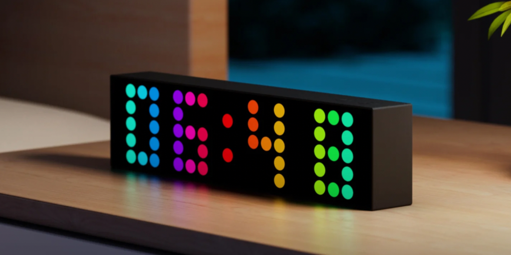

A Home Assistant custom integration for the **Yeelight Cube Smart Lamp Lite**, a lamp with a **20×5 RGB LED matrix** (100 individually addressable pixels). Get full pixel-level control from your HA dashboard: draw pixel art, display scrolling text, apply gradients, color effects, and more.

[![Home Assistant][ha_badge]][ha_link] [![HACS][hacs_badge]][hacs_link] [![GitHub Release][release_badge]][release] [![Buy Me a Coffee][bmac_badge]][bmac]

## See what you can build

[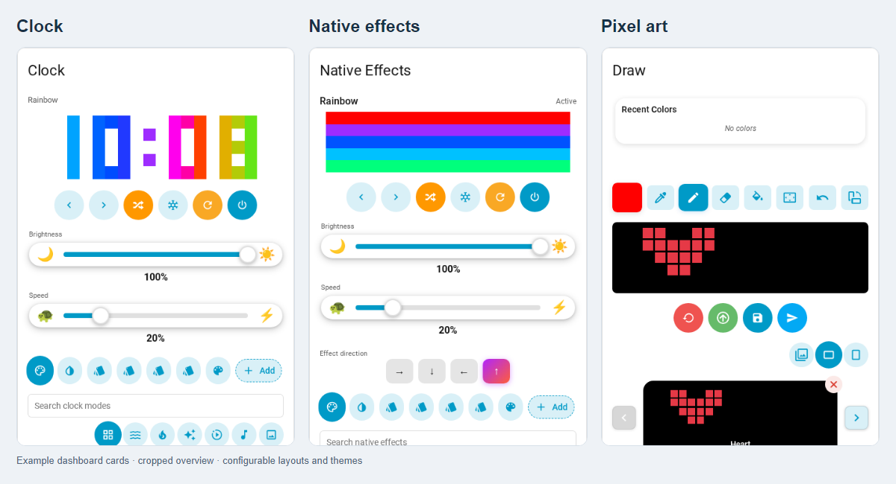](#lovelace-cards)

[Clock](#clock-card) / [Native effects](#native-effects-card) / [Pixel art](#draw-card)

<details>
<summary>See preview, gradient and palette controls</summary>

[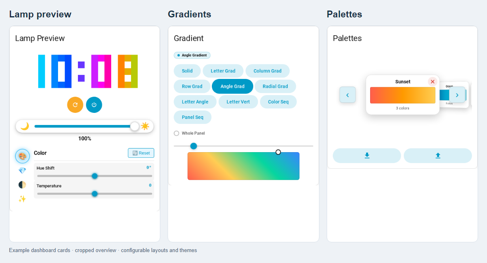](#lovelace-cards)

[Preview](#preview-card) / [Gradients](#gradient-card) / [Palettes](#palettes-card) / [Colors](#colors-card)

</details>

These overviews use generated screenshots of the actual cards with example data.
[Install with HACS](#installation-via-hacs), then [add your lamp](#setup).

---

## Table of Contents

**[`Cards at a glance`](#see-what-you-can-build)** · **[`Features`](#features)** · **[`Installation`](#installation-via-hacs)** · **[`Setup`](#setup)** · **[`Matter & buttons (optional)`](#matter-optional)** · **[`Lovelace Cards`](#lovelace-cards)** · **[`Entities`](#entities-created)** · **[`Automations`](#automations--node-red)** · **[`Display Modes`](#display-modes)** · **[`Requirements`](#requirements)** · **[`Devices`](#supported-devices)** · **[`Limitations`](#known-limitations)** · **[`Power Supply`](#power-supply)** · **[`Troubleshooting`](#troubleshooting)** · **[`License`](#license)**

---

## Features

| What you can do | Where to start |
| :-- | :-- |
| Display a clock with time/date styles, colours and favourites | [Clock Card](#clock-card) |
| Play native animations | [Native Effects Card](#native-effects-card) |
| React to room sound with the lamp's microphone | [Music Flow: use the device's select controls](#music-flow) |
| Draw pixel art or choose from 68 bundled official drawings | [Draw Card](#draw-card) |
| Show scrolling text, palettes and gradients | [Colors](#colors-card) / [Palettes](#palettes-card) / [Gradient](#gradient-card) |
| Preview the lamp live and adjust its brightness and colors | [Preview Card](#preview-card) |
| Use the lamp's buttons in automations and restore the display after a press | [Matter and buttons (optional)](docs/MATTER.md) |
| Keep control local, with automatic network discovery and no cloud dependency | [Setup](#setup) |

All seven cards have visual editors, light/dark themes and configurable layouts.
Normal display controls use **LAN Control**; **Matter is an optional extra**.

> **Yeelight Cube Matrix** (the original Yeelight Cube, a base and 5×5 modules, LAN model `CubeMatrix`) is supported
> too: text, drawings, colours, every native effect, animation and clock style. It is a very different lamp: it has
> **no LAN command for its effects, clock or drawings** — only Matter starts them. So for a Cube Matrix, **Matter is
> not optional if you want smooth effects**: shared to Home Assistant's Matter integration, it runs its own 50 effects (Fireworks included),
> its clock and drawings itself; everything else (and everything without Matter, or while its demo mode runs) is drawn
> by Home Assistant and streamed: as the lamp's drawing over Matter at 25 frames a second, or without Matter over the
> LAN at about 5. No microphone effects, Music Flow or power-on
> behaviour on it. Side-by-side comparison: [docs/CUBE_MATRIX.md](docs/CUBE_MATRIX.md#cube-lite-and-cube-matrix-compared).

---

## Installation via HACS

### HACS (Recommended)

<div align="left">
  <a href="https://my.home-assistant.io/redirect/hacs_repository/?owner=Max-src&repository=yeelight-cube-lite" target="_blank" rel="noopener noreferrer">
    
  </a>
</div>

Or manually add the custom repository:

<details>
<summary>Step-by-step HACS installation</summary>

1. Open **HACS** in your Home Assistant dashboard
2. Click the **⋮** menu (top right) → **Custom repositories**
3. Add this URL and set the category to **Integration**, then click **Add**:
   ```
   https://github.com/Max-src/yeelight-cube-lite
   ```
4. The repository now appears in the custom repositories list. Close the dialog.
5. Back in HACS, search for **Yeelight Cube Lite** and open the result
6. Click **Download** (or **Install**) and confirm
7. **Restart Home Assistant**

</details>

<details>
<summary>Manual installation, updates and removal</summary>

### Manual Installation

1. Download the [latest release](https://github.com/Max-src/yeelight-cube-lite/releases)
2. Copy the contents into `custom_components/yeelight_cube/` inside your HA config directory
3. Restart Home Assistant

### Updating

After updating through HACS or replacing the integration files manually, restart
Home Assistant so the updated Python code and new entities are loaded. Existing
device entries, settings, palettes, and personal pixel art are preserved. If a
dashboard card does not update after the restart, perform a hard browser refresh
(`Ctrl+F5`).

### Removing the integration

If you enabled **Buttons: Right as Remote**, switch it off and wait for
`remote_status: disabled` before removal, so your button playlist is restored.
See [remote-mode recovery](docs/MATTER.md#limits-and-what-to-expect).

1. Remove the cards from your dashboards (they show an error once the
   integration is gone).
2. In **Settings → Devices & services → Yeelight Cube Lite**, open each lamp's
   **⋮** menu and choose **Delete**. Its devices and entities are removed with
   it; the lamp itself keeps working with the Yeelight app.
3. In **HACS**, open **Yeelight Cube Lite** and choose **Remove** (for a manual
   installation, delete `custom_components/yeelight_cube/`), then restart
   Home Assistant.
4. The cards were added as dashboard resources: remove the ones starting with
   `/yeelight_cube/` in **Settings → Dashboards → ⋮ → Resources** (shown with
   *Advanced mode* on in your user profile).

Your saved palettes, drawings and clock presets stay in
`.storage/yeelight_cube.storage` in the configuration folder, so a later
reinstallation finds them (a deleted lamp's favourites and rotation are
removed with it); delete that file to remove them too.

</details>

---

## Setup

### Prerequisites: the Yeelight App

Before adding the lamp to Home Assistant, you must first set it up using the official **Yeelight** app by Qingdao Yeelink ([App Store](https://apps.apple.com/us/app/yeelight/id6443416826) · [Google Play](https://play.google.com/store/apps/details?id=com.yeelight.yeelight_fluid)).

Use **Yeelight** (formerly *Yeelight Station*), the app for Cube, Beam and
Obsid products. Yeelight Classic and Yeelight Pro do not support this lamp.

<details>
<summary>View setup steps</summary>

1. **Download the Yeelight app** from the [App Store](https://apps.apple.com/us/app/yeelight/id6443416826) (iOS) or [Google Play](https://play.google.com/store/apps/details?id=com.yeelight.yeelight_fluid) (Android). Not *Yeelight Classic* or *Yeelight Pro*
2. **Power on the lamp**
3. **Add the lamp to the app**: follow the in-app instructions to connect the lamp to your **2.4 GHz Wi-Fi network**

<!-- 📸 SCREENSHOT (optional): adding the Cube Lite in the app (the "add device" screen or the lamp
     found during pairing). Suggested file: images/App_Add_Device.jpg; it can join the table below
     as its first cell. -->

4. **Enable LAN Control**: in the app, go to your lamp's **Device Settings** and activate **LAN Control**. This is required for the integration to communicate with the lamp over your local network
5. **Find the lamp's IP address**: in Device Settings → **Device info**, find the IP address assigned to the lamp (e.g. `192.168.4.139`)
6. **Save the lamp's orientation**: open the lamp's orientation (direction) page, pick the arrow for how the lamp is mounted, and tap **Save**. The lamp turns its built-in effects by this setting: see [Set the lamp's orientation](#set-the-lamps-orientation-before-judging-effect-directions)

<!-- 📸 SCREENSHOTS TO CHECK: the three images below were taken in the app when it was still called
     Yeelight Station. If the current app's screens look different (titles, layout, the LAN Control
     switch, Device info), replace them, keeping the same file names:
     images/App_Device_Settings.jpg, images/App_LAN_Control.jpg, images/App_Device_Info.jpg -->

<table>
  <tr>
    <td>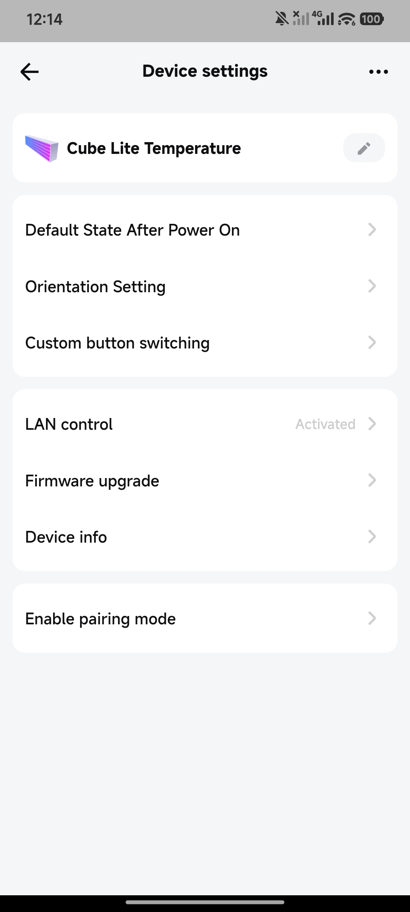</td>
    <td>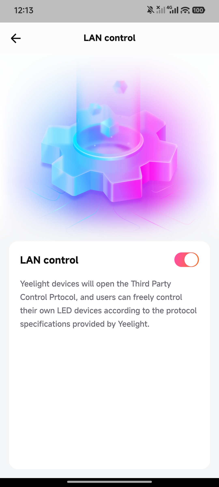</td>
    <td>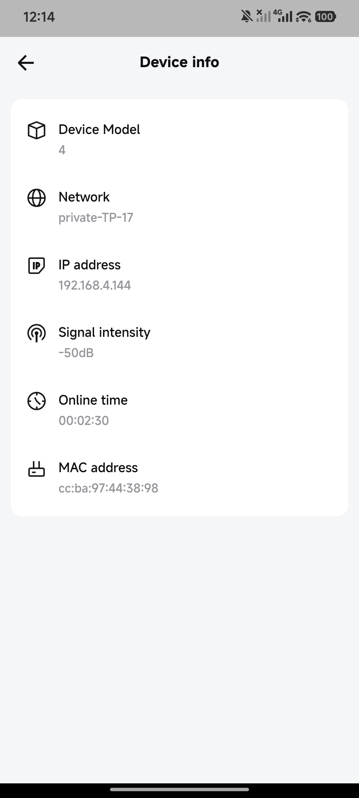</td>
  </tr>
</table>

<blockquote><strong>💡 Tip:</strong> You can also find the lamp's IP from your router's admin page or DHCP client list. Assigning a <strong>static IP / DHCP reservation</strong> is recommended.</blockquote>

</details>

### Adding to Home Assistant

#### Automatic Discovery (recommended)

Once the lamp is on your network with LAN Control enabled, Home Assistant will **automatically detect it** via Zeroconf (mDNS) - no IP address needed.

<details>
<summary>View discovery steps</summary>

1. Look for the **Yeelight Cube Lite** discovery notification on **Settings → Devices & Services**

   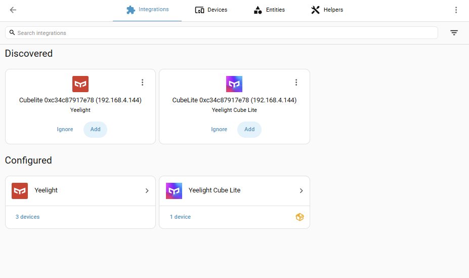

2. Click **Add**

   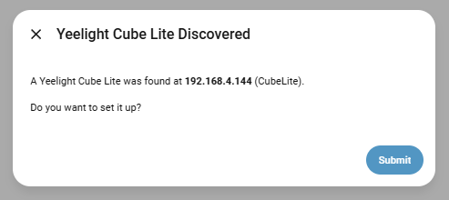

3. Confirm to set up the device

   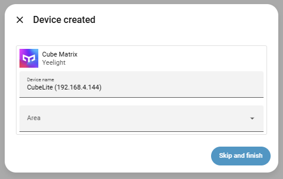

4. Done. The integration creates all entities automatically.

   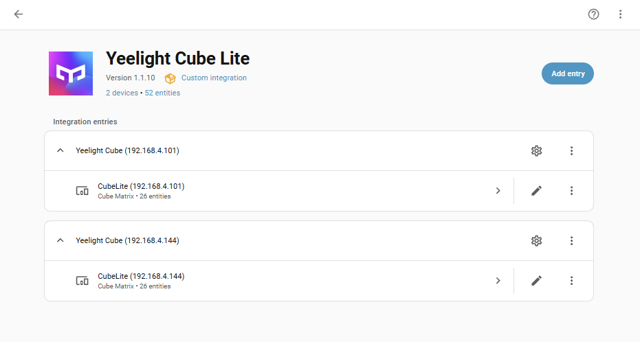

<blockquote><strong>ℹ️ Note:</strong> If you also use the official Yeelight integration, it may generate a discovery notification for the same lamp. That notification is <strong>automatically suppressed</strong> by this integration - you can safely ignore it.</blockquote>

<blockquote><strong>💡 Tip:</strong> <strong>IP address changes:</strong> The integration uses auto-rediscovery. If the lamp gets a new IP (e.g. after a router reboot), the integration finds it again automatically.</blockquote>

</details>

#### Manual Setup (alternative)

If the lamp is not discovered automatically (e.g. different subnet or mDNS is blocked):

<details>
<summary>View manual setup steps</summary>

1. Go to **Settings → Devices & Services**
2. Click **+ Add Integration** (bottom right)
3. Search for **Yeelight Cube Lite** and select it
4. On this integration detail page, click **Add entry**

   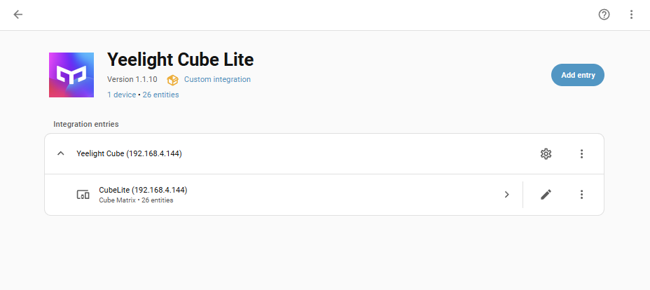

5. Enter the **IP address** from the Yeelight app (e.g. `192.168.4.139`)

   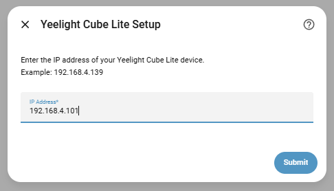

6. Click **Submit**

   

<blockquote><strong>ℹ️ Note:</strong> Each lamp needs to be added separately. If you have multiple lamps, repeat the process for each one.</blockquote>

</details>

#### Set the lamp's orientation (before judging effect directions)

The lamp saves an orientation (the Yeelight app's orientation page: the
arrow you pick, then **Save**; 0°, 90°, 180° or 270°) and turns **every
built-in effect's direction** by it. Your drawings, text and pictures are not
affected. Home Assistant cannot read this setting over your local network, so
it asks **when you add the lamp** (*How is the lamp mounted?*):

| Your situation | Choose |
| :-- | :-- |
| You saved an arrow in the app | The same arrow (left 0°, up 90°, right 180°, down 270°) |
| Never set in the app, or after a factory reset | **Arrow down (270°), or never set**: what such a lamp runs. Or, better, set it in the app now (orientation page, the arrow for how the lamp is mounted, **Save**) and choose that arrow |
| Not sure | **Check it on the lamp**: it shows shooting stars, you say which way they fly (as you see the lamp, mounted as its **Device Orientation** says), and it tells you the app's arrow before saving it |
| The lamp is (or will be) in Home Assistant's Matter integration | **Read it over Matter**: an orientation saved in the app is read from the lamp, and followed when you change it later |

**Later changes:** without Matter, Home Assistant cannot see a change made
later in the app: choose the new arrow in the lamp's **Configure**
(**Settings → Devices & services → Yeelight Cube Lite**, the lamp's entry).
With Matter, it follows on its own. A lamp added with an earlier version, or
whose orientation is still unknown after 10 minutes, gets a **Repairs**
message (*Set the orientation of …*) pointing to **Configure**.

Until it is known, effects move as for **270°** (earlier versions assumed
180°: if you had saved 180° in the app, choose it in **Configure**). Over
Matter, a lamp whose orientation was never saved gets **Device Orientation**
written once (with a Matter server that delivers Yeelight's settings): see
[Matter](docs/MATTER.md#the-lamps-orientation).

> [!IMPORTANT]
> **A factory reset** (both buttons held about 6 seconds) erases the saved
> orientation: the lamp then behaves as 270° until it is saved again. Save it
> again in the app, or set it again in **Configure**. A reset also removes the
> lamp from Matter: pair it with Home Assistant's Matter integration again.

The light's `mount_profile` attribute shows the known orientation (`profile`
0-3 for 0°-270°, or `null`), where it comes from (`source`: `matter`, `user`
or `unknown`), and the one in use (`in_use`: the default 3 when unknown).

#### Matter (optional)

**You do not need Matter for the cards, clock, text, drawings or effects.**
The integration controls those over your local network with LAN Control.

Adding the same lamp to Home Assistant's Matter integration also enables
**button events for automations** and follows supported changes made on the
lamp or in the Yeelight app. Two switches turn the lamp's buttons into a
remote, one per button: **Buttons: Right as Remote** restores the
integration's display after a right-button press, and **Buttons: Left as
Remote** after the left button starts music (it also catches music commands
from apps). **Buttons: Wake Lamp When Off** decides whether a press turns an
off lamp on, or only fires its event. Ordinary external changes are
accepted. A brief flash can remain.

> [!NOTE]
> **Buttons: Right as Remote** and the lamp's direction from **Device
> Orientation** need Yeelight's Matter commands, which Home Assistant's
> Matter server supports from matterjs-server 1.5.4. With an older server,
> the button events and the other two switches still work.

[Set up Matter, use button events, and understand remote mode](docs/MATTER.md)

---

## Lovelace Cards

This component includes custom Lovelace cards for your dashboards.

Every card comes with a **visual configuration editor** - click the pencil icon to customize without YAML. Each section can be configured independently, and most sections offer **multiple display styles and layout modes**. Every card also accepts `title`, `show_card_background` (off: a transparent card) and `show_lamp_status` (the lamp's state in the header).

> [!IMPORTANT]
> After installing or updating, do a hard refresh (`Ctrl+F5`) in your browser if the cards don't appear.

<details>
<summary>Full dashboard examples</summary>

<table>
  <tr>
    <td>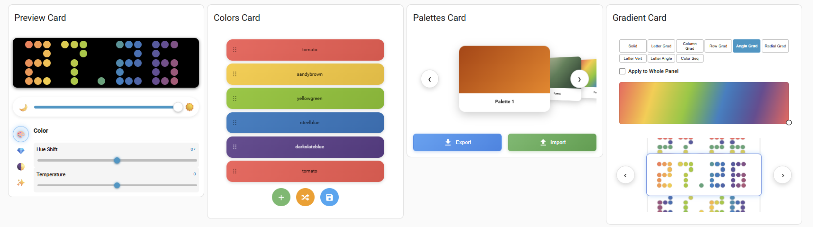</td>
    <td>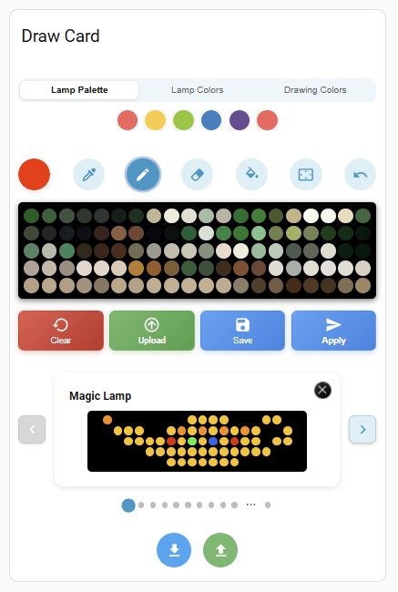</td>
  </tr>
</table>

</details>

<a id="clock-card"></a>

### Clock Card (`custom:yeelight-cube-clock-card`)

Browse built-in clock styles with live time/date previews, choose a color mode
or custom RGB, and save your favourite style-and-color combinations. The card
also provides content/format controls, brightness, animation speed, and a
server-side favourites rotation that continues after you close the dashboard.

<details>
<summary>Style browsing and filtering</summary>

The Clock and Native Effects cards offer **Text**, **Live Preview**, and
**Original** browsers in the visual editor's **Previews** section. Styles
follow your configured order and filter to those that respond to the selected
colour mode or RGB override, without deleting favourites.

See [card configuration and behaviour](SERVICES.md#clock-and-native-effects-cards)
for layouts, offline editing and multi-lamp rotation.

</details>

<details>
<summary>View card variations</summary>

<!-- card-docs:clock:variations:start -->
<table>
  <tr>
    <td valign="top">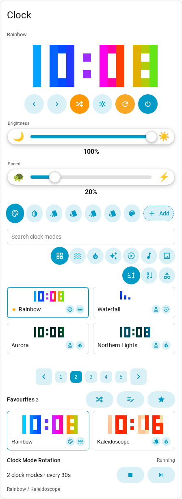<br>Square pixels and capsule sliders</td>
    <td valign="top">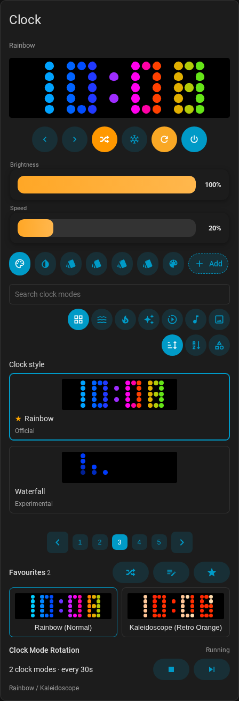<br>Dark theme, round pixels and list gallery</td>
    <td valign="top">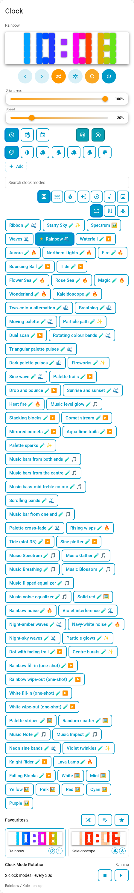<br>Rounded pixels and compact text styles</td>
  </tr>
  <tr>
    <td valign="top">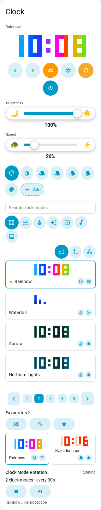<br>Narrow dashboard column</td>
    <td valign="top">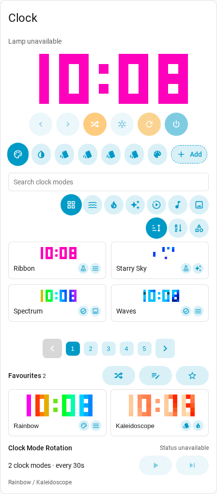<br>Local previews while the lamp is unavailable</td>
    <td valign="top">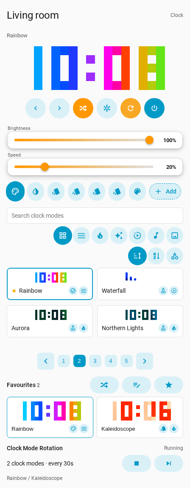<br>Card title, lamp status and no card background</td>
  </tr>
</table>
<!-- card-docs:clock:variations:end -->

</details>

**Features:**

| Feature | Description |
| :-- | :-- |
| **Clock preview** | Live time/date preview using the lamp's native font, with configurable pixels, spacing, background, shadow and size |
| **Style browser** | Search clock styles using text styles (Filled, Dropdown, or Chips with a live mini preview), live-preview layouts (List, Grid, Mosaic, Strip, Carousel, Wheel or Album) or the Original grid or list, with pagination and favourite markers. The editor's **Styles** list picks, orders and renames them for the card (or show them A → Z). Your custom styles can be renamed and deleted (with confirmation) from the gallery. A **family filter** beside the search field (All, Waves, Glow, Sparkles, Motion, Still) shows one kind of style: solid colors and custom styles are under Still, and the rest follow their effect. It offers the families the card has, this browser remembers the choice, and the editor can hide it |
| **Color modes** | Choose supported palettes or custom RGB; save reusable color modes and clock presets |
| **Sliders** | Brightness, speed and intensity with selectable slider styles, labels and values; speed and intensity are shown only when the style's background uses them, or greyed out in place with **Grey out unused sliders** |
| **Content & format** | Switch time/date, 12/24-hour format and colon blinking |
| **Actions** | Previous, next, random, freeze, refresh and power controls |
| **Lamp mounted** | Right / Down / Left / Up, shown when a Matter server that sends Yeelight commands lets it reach the lamp's clock: the lamp then turns the digits for the mount, the background stays where it is on the panel, and the previews show it so |
| **Favourites & rotation** | Save style-and-color combinations on the lamp (the same on every dashboard and device); rotate at a configurable interval, even after closing the dashboard |
| **Multiple lamps & offline editing** | Target several lamps; previews and color choices remain available while lamps are unavailable |

<details>
<summary>View editor sections</summary>

<!-- card-docs:clock:editors:start -->
<table>
  <tr>
    <td valign="top">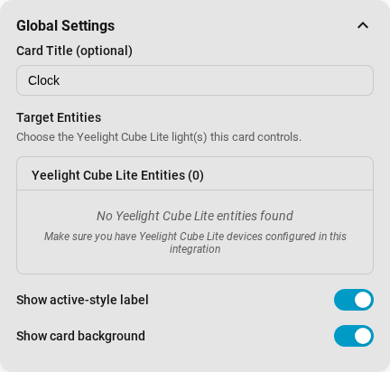<br>Global Settings</td>
    <td valign="top">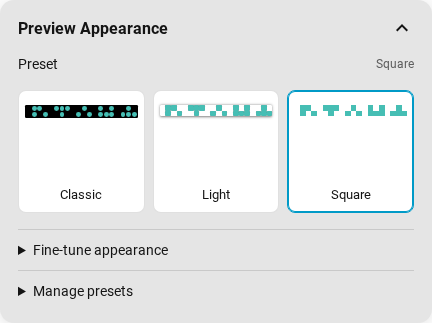<br>Preview Appearance</td>
    <td valign="top">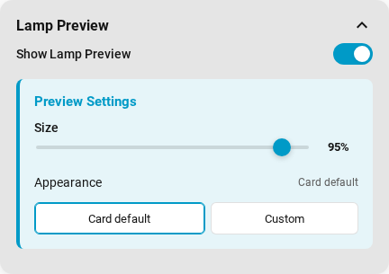<br>Lamp Preview</td>
  </tr>
  <tr>
    <td valign="top"><br>Actions</td>
    <td valign="top"><br>Sliders</td>
    <td valign="top">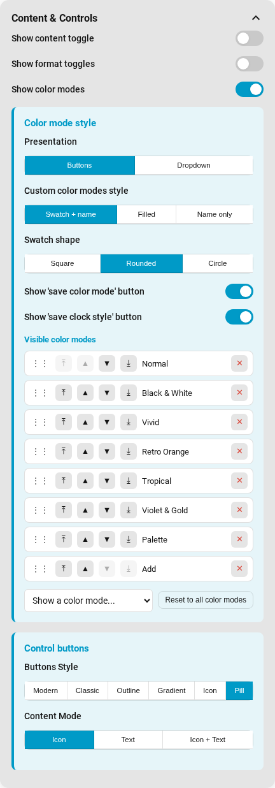<br>Content &amp; Controls</td>
  </tr>
  <tr>
    <td valign="top">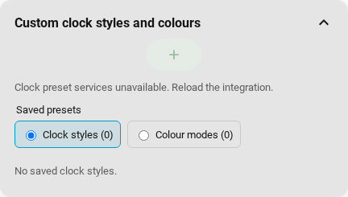<br>Custom clock styles and colors</td>
    <td valign="top">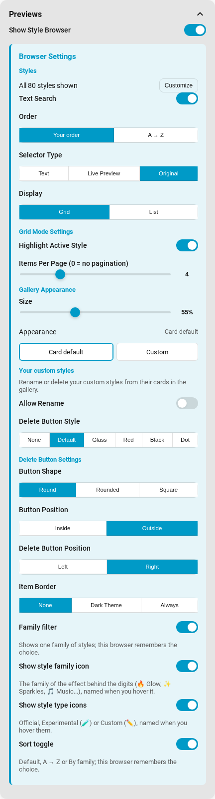<br>Previews</td>
    <td valign="top">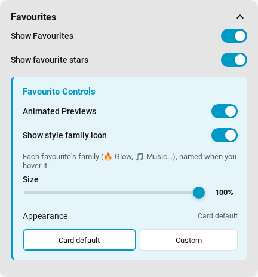<br>Favourites</td>
  </tr>
  <tr>
    <td valign="top">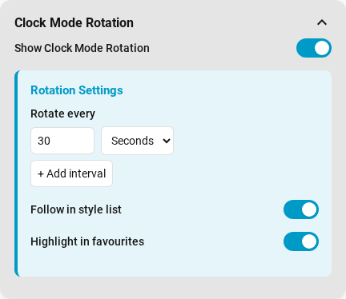<br>Clock Mode Rotation</td>
  </tr>
</table>
<!-- card-docs:clock:editors:end -->

</details>

<details>
<summary>YAML example</summary>

```yaml
type: custom:yeelight-cube-clock-card
entity: light.cubelite_a904
title: Clock
show_current_preview: true
show_brightness: true
show_animation_speed: true
slider_style: capsule
show_color_modes: true
show_gallery: true
style_selector_style: original
effect_view: grid
items_per_page: 4
show_favourites: true
show_rotation: true
rotation_interval: 30   # seconds; used until the lamp has its own interval
```

</details>

Several lamps, favourites and rotation work as for the Native Effects Card
(see [Shared behaviour](#native-effects-card) below).

---

<a id="native-effects-card"></a>

### Native Effects Card (`custom:yeelight-cube-native-effects-card`)

Browse the lamp's built-in animations with local animated previews. Choose
supported palette modes or custom RGB, manage favourites, and rotate through
them. Brightness, speed, orientation, Freeze, Refresh, and power controls are
available where supported.

<details>
<summary>View card variations</summary>

<!-- card-docs:native-effects:variations:start -->
<table>
  <tr>
    <td valign="top">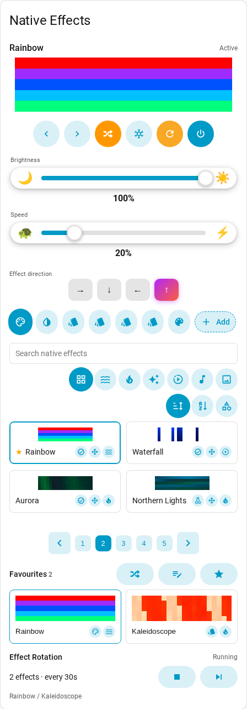<br>Square pixels and capsule sliders</td>
    <td valign="top">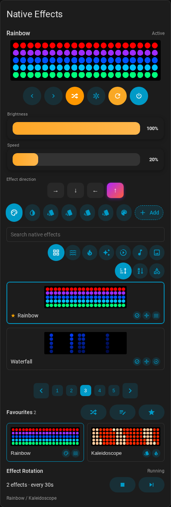<br>Dark theme, round pixels and list gallery</td>
    <td valign="top">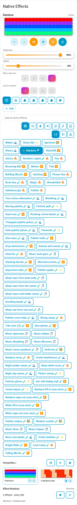<br>Rounded pixels and compact text effects</td>
  </tr>
  <tr>
    <td valign="top">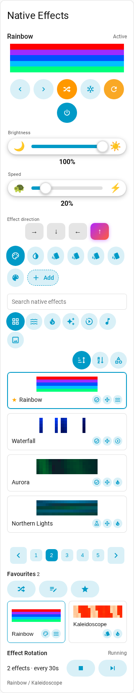<br>Narrow dashboard column</td>
    <td valign="top">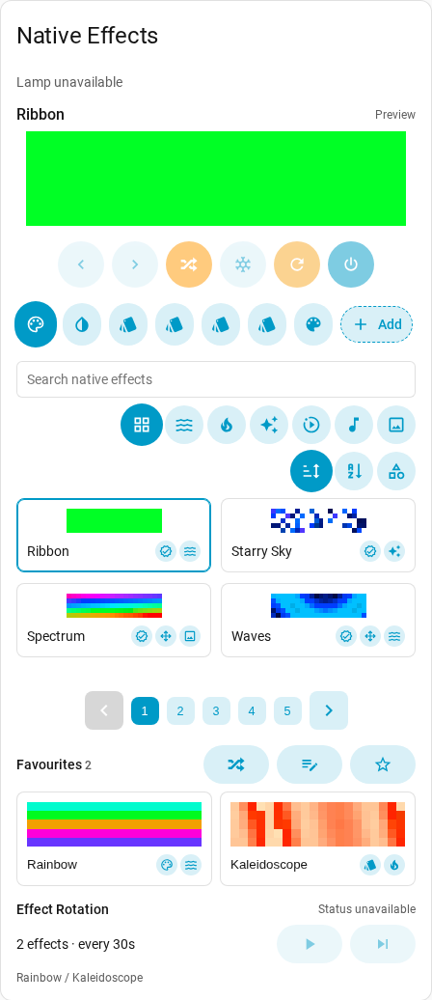<br>Local previews while the lamp is unavailable</td>
    <td valign="top">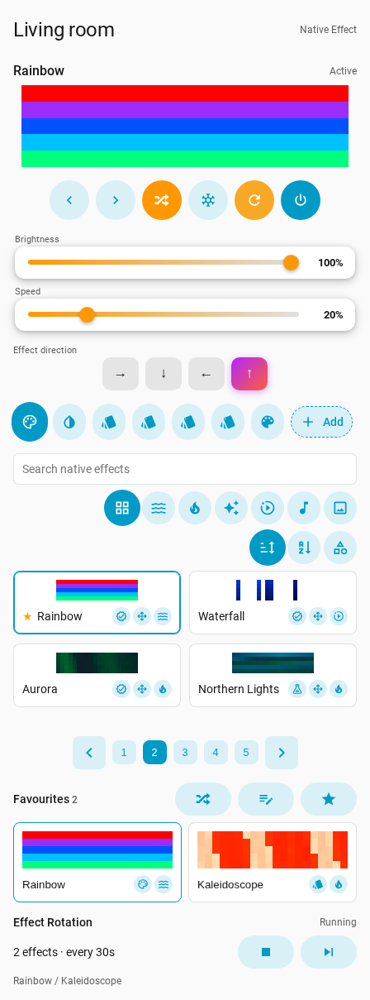<br>Card title, lamp status and no card background</td>
  </tr>
</table>
<!-- card-docs:native-effects:variations:end -->

</details>

**Features:**

| Feature | Description |
| :-- | :-- |
| **Live previews** | Preview built-in animations with configurable pixels, spacing, background, shadow and size |
| **Effect browser** | Search effects using text styles (Filled, Dropdown, or Chips with a live mini preview), live-preview layouts (List, Grid, Mosaic, Strip, Carousel, Wheel or Album) or the Original grid or list, with pagination and availability badges. The editor's **Effects** list picks, orders and renames them for the card (or show them A → Z) A **family filter** beside the search field (All, Waves, Glow, Sparkles, Motion, Music, Still) shows one kind of effect; it offers the families the card has, this browser remembers the choice, and the editor can hide it. Each effect, in the browser and the favourites, shows its family's icon at the bottom right, never over its preview (a flame for Glow, a sparkle for Sparkles, a note for Music, waves, a play arrow for Motion, a picture for Still), colored like the card's buttons; hovering it names the family. Chips show it after the name, the dropdown and text buttons the family's emoji (🌊 🔥 ✨ ▶️ 🎵 🖼️). The editor's **Show effect family icon** turns them off in the browser, the Favourites section's own **Show effect family icon** for the favourites. |
| **Color modes** | Apply supported palette modes or custom RGB; favourites remember the chosen colors |
| **Sliders** | Brightness, effect speed and intensity with selectable slider styles; speed and intensity are shown only for effects that use them, or greyed out in place with **Grey out unused sliders** |
| **Orientation & actions** | Device orientation, previous, next, random, freeze, refresh and power controls |
| **Favourites & rotation** | Order saved effect-and-color combinations and rotate them on the lamp at a configurable interval |
| **Multiple lamps & offline editing** | Control several targets; browse previews even while lamps are unavailable |

<details>
<summary>View editor sections</summary>

<!-- card-docs:native-effects:editors:start -->
<table>
  <tr>
    <td valign="top">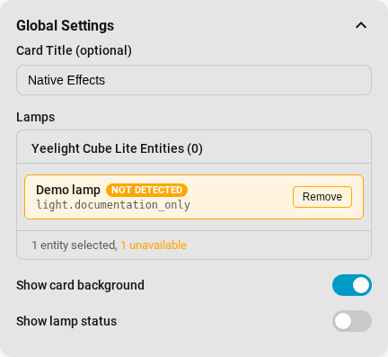<br>Global Settings</td>
    <td valign="top"><br>Preview Appearance</td>
    <td valign="top">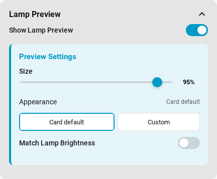<br>Lamp Preview</td>
  </tr>
  <tr>
    <td valign="top">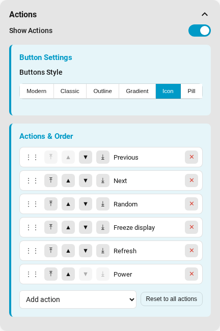<br>Actions</td>
    <td valign="top">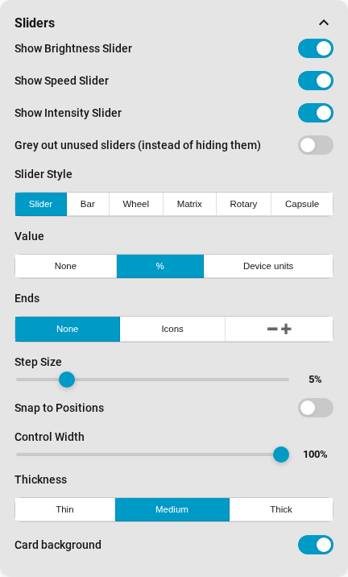<br>Sliders</td>
    <td valign="top">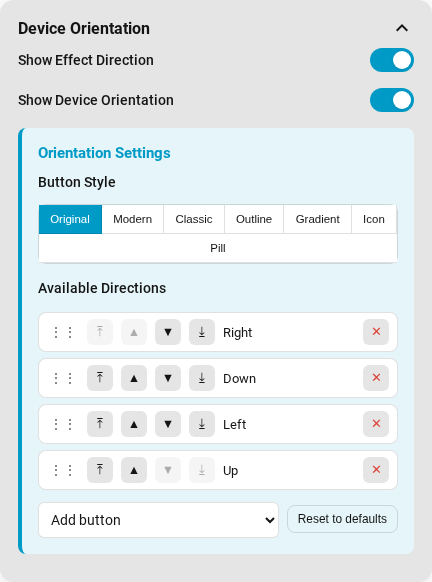<br>Device Orientation</td>
  </tr>
  <tr>
    <td valign="top">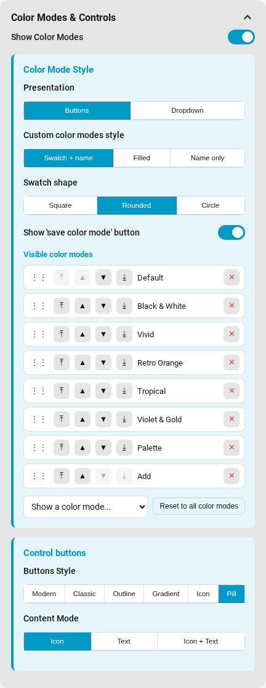<br>Color Modes &amp; Controls</td>
    <td valign="top">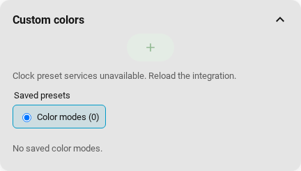<br>Custom colors</td>
    <td valign="top">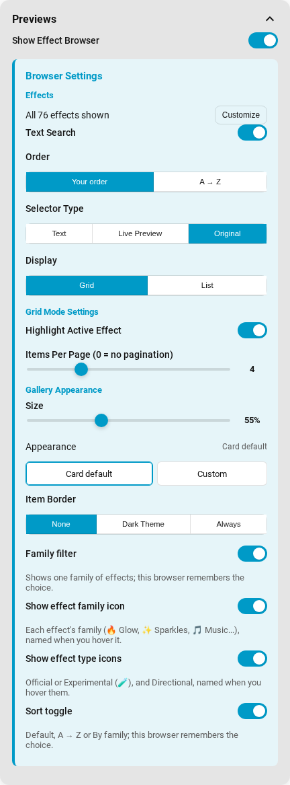<br>Previews</td>
  </tr>
  <tr>
    <td valign="top">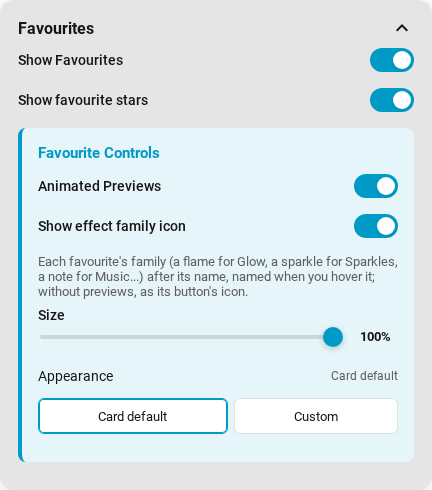<br>Favourites</td>
    <td valign="top">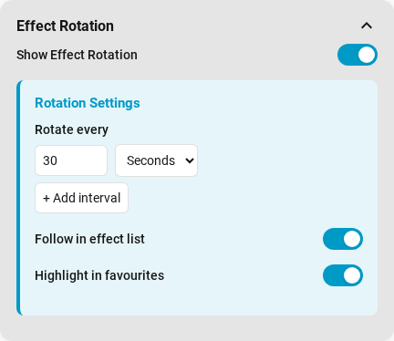<br>Effect Rotation</td>
  </tr>
</table>
<!-- card-docs:native-effects:editors:end -->

</details>

<details>
<summary>YAML example</summary>

```yaml
type: custom:yeelight-cube-native-effects-card
entity: light.cubelite_a904
title: Native Effects
show_preview: true
show_brightness: true
show_animation_speed: true
slider_style: capsule
show_color_modes: true
show_gallery: true
style_selector_style: original
effect_view: grid
items_per_page: 4
show_favourites: true
show_rotation: true
rotation_interval: 30   # seconds; used until the lamp has its own interval
```

</details>

**Shared behaviour (Clock and Native Effects):** favourites store the
style/effect with its color mode and custom RGB, separately for each card
kind, and are saved on the lamp in Home Assistant, so every dashboard, browser
and device shows the same favourites, rotation interval and rotation status.
Rotation needs at least two available favourites, runs in Home Assistant and
resumes after a restart. Use `target_entities` (a list of light entity IDs)
for several lamps. While a lamp is unavailable, previews and color choices
stay usable and hardware controls are gated; with several lamps, the cards
keep controlling the available ones and name the offline ones.

In detail: [card options, favourites, rotation, sliders and offline use](SERVICES.md#clock-and-native-effects-cards),
[service calls](SERVICES.md#-clock-native-effects-and-rotation).

---

<a id="preview-card"></a>

### 🖥️ Preview Card (`custom:yeelight-cube-lamp-preview-card`)

A live dashboard card that mirrors the lamp's current state with real-time matrix preview, brightness slider, power & refresh actions, and color adjustments panel.

<details>
<summary>View card variations</summary>

<!-- card-docs:lamp-preview:variations:start -->
<table>
  <tr>
    <td valign="top">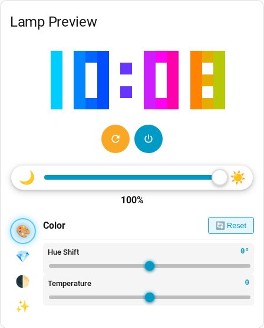<br>Light theme with brightness and color adjustments</td>
    <td valign="top">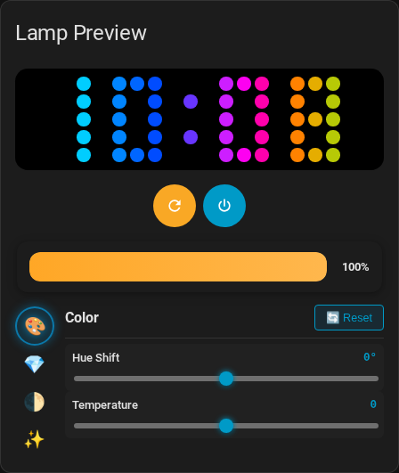<br>Dark theme with round pixels</td>
    <td valign="top">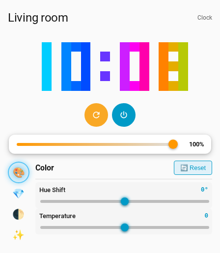<br>Card title, lamp status and no card background</td>
  </tr>
</table>
<!-- card-docs:lamp-preview:variations:end -->

</details>

<details>
<summary>More layout examples</summary>

<table>
  <tr>
    <td>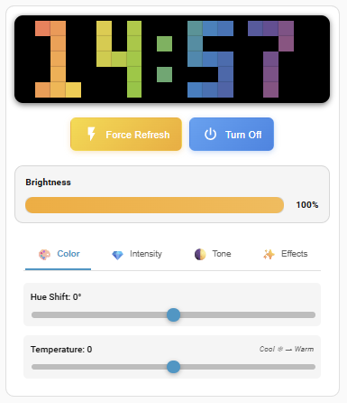</td>
    <td>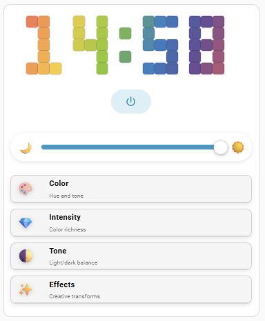</td>
    <td>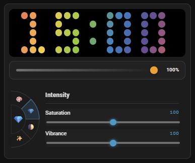</td>
    <td></td>
    <td>
    </td>
  </tr>
</table>

</details>

**Features:**

| Feature | Description |
| :-- | :-- |
| **Lamp preview** | Reflects what's displayed on the lamp. Configurable pixel style, spacing, background, shadow, and size |
| **Refresh & power** | Quick buttons to force-refresh or toggle power |
| **Device orientation** | Right / Down / Left / Up control with configurable button layout; the preview rotates to match the physical mount |
| **Brightness slider** | Configurable slider styles |
| **Color adjustments** | Adjustment sliders with multiple layout modes, change indicators, and reset buttons |

<details>
<summary>View editor sections</summary>

<!-- card-docs:lamp-preview:editors:start -->
<table>
  <tr>
    <td valign="top"><br>Global Settings</td>
    <td valign="top"><br>Preview Appearance</td>
    <td valign="top"><br>Lamp Preview</td>
  </tr>
  <tr>
    <td valign="top"><br>Actions</td>
    <td valign="top"><br>Device Orientation</td>
    <td valign="top"><br>Brightness Settings</td>
  </tr>
  <tr>
    <td valign="top"><br>Color Adjustments</td>
  </tr>
</table>
<!-- card-docs:lamp-preview:editors:end -->

</details>

---

<a id="colors-card"></a>

### 🎨 Colors Card (`custom:yeelight-cube-color-list-editor-card`)

Edit the ordered list of colors used by text display on the lamp. Add, delete, drag to reorder, shuffle, and save as a reusable palette.

<details>
<summary>View card variations</summary>

<!-- card-docs:color-list-editor:variations:start -->
<table>
  <tr>
    <td valign="top"><br>Cards with hex codes, drag to reorder</td>
    <td valign="top"><br>Tiles with the add / shuffle / save actions</td>
    <td valign="top"><br>Dark theme: compact chips</td>
  </tr>
</table>
<!-- card-docs:color-list-editor:variations:end -->

</details>

**Features:**

| Feature | Description |
| :-- | :-- |
| **Multi-entity support** | Control multiple lamps at the same time |
| **Color list** | Add, remove, and reorder by dragging (mouse or touch, the same drag as the Draw and Palettes editors) in six layouts: Cards, Tiles, Rows, Grid, Compact, Chips. Optional hex/name display |
| **Shared look** | **Size** and **Item Radius** like the other cards' galleries (older `card_size` / `rounded_cards` options migrate automatically) |
| **Color edit** | Color picker or hex input |
| **Actions** | Add, shuffle, and save as reusable palette |

<details>
<summary>View editor sections</summary>

<!-- card-docs:color-list-editor:editors:start -->
<table>
  <tr>
    <td valign="top"><br>Global Settings</td>
    <td valign="top"><br>Color List Settings</td>
    <td valign="top"><br>Add/Shuffle/Save Actions</td>
  </tr>
</table>
<!-- card-docs:color-list-editor:editors:end -->

</details>

---

<a id="palettes-card"></a>

### 🎭 Palettes Card (`custom:yeelight-cube-palette-card`)

Manage color palettes. Apply a palette to lamps with one click. Multiple display modes supported.

<details>
<summary>View card variations</summary>

<!-- card-docs:palette:variations:start -->
<table>
  <tr>
    <td valign="top"><br>Album of palettes with gradient backgrounds</td>
    <td valign="top"><br>List with color swatches and their count</td>
    <td valign="top"><br>Dark theme: grid with color stripes</td>
  </tr>
</table>
<!-- card-docs:palette:variations:end -->

</details>

**Features:**

| Feature | Description |
| :-- | :-- |
| **Multi-entity support** | Control multiple lamps at the same time |
| **Browse & apply** | The shared gallery: List, Grid, Mosaic, Strip, Carousel, Wheel or Album previews, or Filled, Dropdown or Chips buttons, with optional search; the shared swatches: Swatches (row, grid, expandable, scroll, fan, wave or spiral; square, rounded or circle), Gradient, Stripes, Fill, Honeycomb, Blinds or Treemap (older `swatch_style` options migrate automatically), and the color count; one-click (or keyboard) apply; in the carousel and wheel the arrows only browse, a click applies. The palette the lamps show is highlighted; your order or A → Z |
| **Manage** | Rename (Allow Rename) and delete palettes from the gallery; a delete always asks for confirmation |
| **Arrange** | Reorder your palettes in the card editor (drag or ▲ ▼); the order is saved for every card, lamp and the Matrix: Palette select |
| **Import/Export** | Load and save full palette collections |

<details>
<summary>View editor sections</summary>

<!-- card-docs:palette:editors:start -->
<table>
  <tr>
    <td valign="top"><br>Global Settings</td>
    <td valign="top"><br>Palettes</td>
    <td valign="top"><br>Import/Export Actions</td>
  </tr>
</table>
<!-- card-docs:palette:editors:end -->

</details>

---

<a id="gradient-card"></a>

### 🌈 Gradient Card (`custom:yeelight-cube-gradient-card`)

Select and configure gradient/color modes. Adjust gradient direction with an angle control. Preview all gradient modes live.

<details>
<summary>View card variations</summary>

<!-- card-docs:gradient:variations:start -->
<table>
  <tr>
    <td valign="top"><br>Mode buttons, active mode and a rectangle angle control</td>
    <td valign="top"><br>Chips with live gradient swatches and a compass</td>
    <td valign="top"><br>Dark theme: dropdown, wheel and panel tabs</td>
  </tr>
</table>
<!-- card-docs:gradient:variations:end -->

</details>

**Features:**

| Feature | Description |
| :-- | :-- |
| **Multi-entity support** | Control multiple lamps at the same time |
| **Unified mode selector** | The same gallery as the Clock and Native Effects cards: 3 lightweight **text** styles (Filled, Dropdown, Chips with live gradient swatches) or 7 **live preview** styles (List, Grid, Mosaic, Strip, Carousel, Wheel, Album) that render a mini matrix of every mode with your current text, colors, and angle — click to apply. Optional text search; the editor's **Modes** list picks, orders and renames them for the card (or show them A → Z) |
| **Shared appearance axes** | **Shape** (Square / Rounded / Round) and **Size** apply consistently to every selector style — same design language as the other cards |
| **Selection feedback** | The chosen item pulses while the command is in flight and settles once the lamp confirms |
| **Active mode label** | Optional chip showing the currently active mode by name (handy when titles are hidden) |
| **Apply to whole panel** | Independent toggle to apply gradients to the full panel instead of just the text |
| **Angle selector** | Rectangle or square bar, wheel (optional arrow mask), compass (needle, beam, arrow, star or rectangle overlay), mini-matrix (optionally showing the lamp's text) or capsule slider; optional snapping to N/NE/E… (all but the mini-matrix) and the angle shown as text or an editable number. A lamp update never moves the angle you are dragging |

> **Upgrading from an older version?** The former "Color Mode Selector" and "Gradient Preview" sections were merged into a single **Mode Selector** — they served the same purpose. Existing configs (including the former angle styles and selector layouts) migrate automatically, in the card and in its editor; pick a text style in the editor if you prefer the old compact buttons. Text styles skip the preview computation entirely, making them noticeably lighter.

<details>
<summary>View editor sections</summary>

<!-- card-docs:gradient:editors:start -->
<table>
  <tr>
    <td valign="top"><br>Global Settings</td>
    <td valign="top"><br>Preview Appearance</td>
    <td valign="top"><br>Active Mode Label</td>
  </tr>
  <tr>
    <td valign="top"><br>Mode Selector</td>
    <td valign="top"><br>Apply to Whole Panel</td>
    <td valign="top"><br>Angle Selector</td>
  </tr>
</table>
<!-- card-docs:gradient:editors:end -->

**Preview Appearance** is the shared matrix look, see
[Shared Preview Appearance](SERVICES.md#shared-preview-appearance).

</details>

---

<a id="draw-card"></a>

### ✏️ Draw Card (`custom:yeelight-cube-draw-card`)

The pixel art editor. Paint on a 20×5 interactive matrix, save designs to a personal gallery, and push artwork to one or more lamps with a single tap.

<details>
<summary>View card variations</summary>

<!-- card-docs:draw:variations:start -->
<table>
  <tr>
    <td valign="top"><br>Colors, tools, a drawing and the pixel-art carousel</td>
    <td valign="top"><br>Pixel-art grid: the art being drawn is highlighted</td>
    <td valign="top"><br>Dark theme: round pixels and pixel-art chips</td>
  </tr>
</table>
<!-- card-docs:draw:variations:end -->

</details>

**Features:**

| Feature | Description |
| :-- | :-- |
| **Multi-entity support** | Control multiple lamps at the same time |
| **Colors section** | Quick access to recent, palette, current, and drawing colors |
| **Drawing tools** | Individually toggleable with multiple styles |
| **Drawing matrix** | Interactive 20×5 matrix, landscape or vertical (Rotate tool; a vertical pixel art opens vertical and is saved so) |
| **Action buttons** | Apply to lamp, upload from image, save, or clear |
| **Pixel art gallery** | The shared gallery: Grid, List, Mosaic, Strip, Carousel, Wheel or Album previews, or Filled, Dropdown or Chips buttons, with optional search. A pick (a click; carousel and wheel arrows only browse) loads the pixel art into the drawing (and sends it to the lamp with "Apply to lamp automatically"); vertical pixel arts show standing up; the pixel art on the canvas is highlighted; your order or A → Z. Rename (Allow Rename) and delete them from the gallery (a delete always asks for confirmation); reorder them in the card editor's Arrange list (saved for every card and the Matrix: Pixel Art select) |
| **Official pixel arts** | The 68 official drawings appear in the gallery beside yours, grouped (All, My drawings, each official collection) as tabs or another section layout; choose which ones the card shows, and filter by orientation (All / Horizontal / Vertical, or follow the lamp's) |
| **Import/Export** | Import and export collections as JSON |

<details>
<summary>View editor sections</summary>

<!-- card-docs:draw:editors:start -->
<table>
  <tr>
    <td valign="top"><br>Global Settings</td>
    <td valign="top"><br>Layout</td>
    <td valign="top"><br>Colors Section</td>
  </tr>
  <tr>
    <td valign="top"><br>Drawing Tools</td>
    <td valign="top"><br>Preview Appearance</td>
    <td valign="top"><br>Drawing Matrix Section</td>
  </tr>
  <tr>
    <td valign="top"><br>Action Buttons</td>
    <td valign="top"><br>Pixel Art Section</td>
    <td valign="top"><br>Import/Export Actions</td>
  </tr>
</table>
<!-- card-docs:draw:editors:end -->

A **Preview Appearance** section (the shared matrix look, see
[Shared Preview Appearance](SERVICES.md#shared-preview-appearance)) sits
between Drawing Tools and Drawing Matrix Section.

</details>

---

<a id="matrix-preview-cameras"></a>

### Matrix Preview Cameras (Picture Entity card)

Each lamp has two camera entities, **Matrix Preview (Round)** and **Matrix
Preview (Square)**: a picture of what the lamp shows, for a quick preview
with Home Assistant's own **Picture Entity** card (or a picture-glance card,
a notification, another app). For an interactive preview with controls and
the same look as the other cards, use the [Preview Card](#preview-card).

- **What it shows:** what you see on the lamp. A lamp mounted **Left** or
  **Up** (upside down) is shown the right way up, and the clock, native
  effects and Music Flow are simulated, as on the cards.
- **How it looks:** a sharp image (1227 × 372 px, 3× the design size) of the
  lamp in a black frame with rounded corners and a soft shadow, on a
  transparent background: the card's own background shows around it.
- **When it renders:** only when an image is requested, from the lamp's
  latest frame: a camera nobody is watching costs nothing.
- **How fast it moves:** set by the card's `camera_view`. With `live`, a stream
  shows Fireworks at up to the lamp's 25 frames a second, as a smaller
  409 × 124 px image (fewer frames on a slow Home Assistant host, which it never
  loads with more than about half a core per camera), and the other effects at
  about 3. With `auto`, Home Assistant's dashboard fetches one full-size picture
  every 10 seconds, whatever the camera does. The stream runs while the card is
  on the page, so prefer `auto` for a card that only needs to show what is on
  the lamp. For sharp, smooth animation, use the [Preview Card](#preview-card).

```yaml
type: picture-entity
entity: camera.living_room_cube_matrix_preview_round
camera_view: live
show_name: false
show_state: false
```

<details>
<summary>Camera orientation, sizing and layout examples</summary>

#### A lamp standing on its end

Turn on the lamp's **Camera Follows Orientation** switch (Configuration, off
by default): while its **Device Orientation** is Down or Up, both cameras
draw the lamp standing up (372 × 1227 px). Off, they stay landscape.

#### Size and fit

A picture card is as wide as its place in the dashboard, and either follows
the image's shape or gets a fixed height. With a fixed height, `fit_mode`
decides how the image fits in:

| Card settings | Lamp lying flat | Lamp standing up |
| :-- | :-- | :-- |
| Natural size: `grid_options: rows: auto` (no `aspect_ratio`) | Fits the width ✓ | Very tall in a wide card: give it a narrow one (`columns: 3`) ✓ |
| Fixed height (`grid_options: rows: 3`, or `aspect_ratio: "2:1"` outside sections) and `fit_mode: contain` | Fits the width, room above and below ✓ | Fits the height, room on the sides ✓ |
| Fixed height and `fit_mode: cover` | Sides cropped ✗ | Only the middle rows, zoomed ✗ |
| Fixed height and `fit_mode: fill` | Stretched ✗ | Stretched ✗ |

**For a lamp you turn between orientations**, one card works for both: a
fixed height with `fit_mode: contain`. Three rows is a good balance (about
190 px: a full-width flat lamp, a standing one about 190 px tall); more rows
make the standing lamp larger and leave more room around the flat one.

```yaml
type: picture-entity
entity: camera.living_room_cube_matrix_preview_round
camera_view: auto
fit_mode: contain
show_name: false
show_state: false
grid_options:
  columns: 12
  rows: 3
```

**For the best size in each orientation**, use two cards that show by the
lamp's orientation, each at the image's natural size:

```yaml
# Lying flat (Right / Left): full width
type: conditional
conditions:
  - condition: state
    entity: select.living_room_cube_device_orientation
    state_not: [Up, Down]
card:
  type: picture-entity
  entity: camera.living_room_cube_matrix_preview_round
  camera_view: auto
  show_name: false
  show_state: false
grid_options:
  columns: 12
  rows: auto
---
# Standing up (Up / Down): a narrow card
type: conditional
conditions:
  - condition: state
    entity: select.living_room_cube_device_orientation
    state: [Up, Down]
card:
  type: picture-entity
  entity: camera.living_room_cube_matrix_preview_round
  camera_view: auto
  show_name: false
  show_state: false
grid_options:
  columns: 3
  rows: auto
```

</details>

<details>
<summary>View the camera's fits</summary>

<!-- card-docs:camera:variations:start -->
<table>
  <tr>
    <td valign="top"><br>Lying flat: natural size (rows: auto)</td>
    <td valign="top"><br>Lying flat: fixed height, fit_mode: contain</td>
    <td valign="top"><br>Standing up: fixed height, fit_mode: contain</td>
  </tr>
  <tr>
    <td valign="top"><br>Standing up: natural size in a narrow card (columns: 3)</td>
    <td valign="top"><br>Lying flat: fit_mode: cover (crops the sides)</td>
    <td valign="top"><br>Standing up: fit_mode: cover (crops to the middle)</td>
  </tr>
  <tr>
    <td valign="top"><br>Lying flat: fit_mode: fill (stretches)</td>
    <td valign="top"><br>Standing up: fit_mode: fill (stretches)</td>
    <td valign="top"><br>The Square camera (square pixels)</td>
  </tr>
</table>
<!-- card-docs:camera:variations:end -->

</details>

---

<a id="matrix-modules-card"></a>

### 🧩 Cube Matrix Modules Card (`custom:yeelight-cube-matrix-modules-card`)

Set which modules a **Cube Matrix** has and the side its power supply is on, as on the Yeelight app's module
page. The card shows the modules as they are fitted, from the power supply: add a Matrix, Spot or Panel module at
the end of the chain (up to 6), remove any with its ✕, and pick the power supply's side (Left, Right, Down or Up;
the chain is drawn that way). Edits stay a draft until **Save**, which sends
[`set_matrix_modules`](SERVICES.md#set_matrix_modules) (over Matter) and the matching Device Orientation;
**Reset** shows the lamp's modules again.

```yaml
type: custom:yeelight-cube-matrix-modules-card
target_entities:
  - light.cubematrix_6a80
```

| Option | Description |
| :-- | :-- |
| `target_entities` | The Cube Matrix lamps, each set up in its own block (a Cube Lite has no modules) |
| `buttons_style`, `buttons_content_mode` | The shared button look |

---

## Entities Created

Each lamp creates its own set of per-device entities, plus the integration creates **global entities** (palettes, drawings, fonts, clock color presets) shared across all lamps.

> [!NOTE]
> The names below are the entity names shown on the device page. Matrix-only
> controls carry a `Matrix:` prefix and clock options a `Clock:` prefix so they
> group together. Entity IDs are derived from the lamp name, e.g.
> `select.cubelite_a904_matrix_display_mode`.

### Per-device Entities

<details>
<summary>View entity screenshots</summary>

<table>
  <tr>
    <td></td>
    <td></td>
    <td></td>
    <td></td>
  </tr>
</table>

</details>

<details>
<summary>All per-device controls, settings and diagnostics</summary>

#### Controls

| Entity | Type | Description |
| :-- | :-- | :-- |
| **Auto Turn On** | Switch | Automatically turn on the lamp when a mode, drawing, text or color change is applied while it is off. When disabled, the change is kept and shown when the lamp is turned on |
| **(the lamp's name)** | Light | Main light entity, named after the lamp (on/off and brightness; RGB color in Matrix mode) |
| **Content mode** | Select | Switch between Matrix, built-in Clock, Native Effect, and Music Flow |
| **Matrix: Display Mode** | Select | Choose the Matrix render mode (see [Display Modes](#display-modes)) |
| **Matrix: Display Text** | Text | Text shown by the Matrix text modes |
| **Matrix: Font** | Select | Basic, Fat, Italic, or Native (Basic with the built-in clock's digit shapes) |
| **Matrix: Text Alignment** | Select | Text alignment: left, center, right |
| **Matrix: Gradient Angle** | Number | Angle for angle-based gradient modes (0°–360°) |
| **Matrix: Palette** | Select | Apply one of the saved color palettes |
| **Matrix: Pixel Art** | Select | Personal drawings followed by the 68 locally bundled, read-only official presets |
| **Clock: Style** | Select | One of the 73 native clock styles: the lamp's 10 and the experimental ones |
| **Native effect** | Select | One of the 71 built-in animations, the experimental ones included (and the four animations to upload, with a Matter server that delivers the Yeelight commands) |
| **Effect speed** | Number | Speed for the native clock and for effects that support it (0–255 device units; unavailable when the effect or clock style shown has no speed control) |
| **Effect intensity** | Number | Intensity for the effects and clock backgrounds that use it (0–255, default 128; never below 13 on Aurora and 1 on Palette stripes, where lower values hang or restart the lamp): the number of glows or meteors, how often stars or drops appear, a wave's size, how strongly music bars react. One setting shared by all effects, like the speed; unavailable when the effect or clock style shown has no intensity |
| **Music Flow effect** | Select | Gather, Breathing, Blossom, Spectrum, Music Note, or Impact |
| **Clock: Content** | Select | What the clock shows: Time, Time & Date (alternating), or Date |
| **Device Orientation** | Select | How the lamp is mounted: Right / Down / Left / Up (applies to all modes). It never changes an effect's direction |

#### Sensors

| Entity | Type | Description |
| :-- | :-- | :-- |
| **Matrix Preview (Round)** | Camera | Local matrix preview with round pixels; Music Flow uses a static effect illustration |
| **Matrix Preview (Square)** | Camera | Local matrix preview with square pixels; Music Flow uses a static effect illustration |
| **Estimated power** | Sensor | Estimated power draw of the lamp in W. See [Power Supply](#power-supply) |
| **Estimated energy** | Sensor | Estimated energy used by the lamp in kWh, for the Energy dashboard. See [Power Supply](#power-supply) |
| **Lamp buttons** | Event | What the lamp's buttons (or the Yeelight app) changed, as events for automations: `right_button`, `effect_changed`, `music_mode_changed`, `music_off`, `turned_on`, `turned_off`. Unavailable until the lamp is linked to Matter: see [Matter (optional)](#matter-optional) |

> [!TIP]
> Use these camera entities with a "Picture Entity" card for quick previews: see [Matrix Preview Cameras](#matrix-preview-cameras) for the card settings that fit a lamp lying flat or standing up. For more responsive previews, use the custom [Preview Card](#preview-card).

#### Configuration

| Entity | Type | Description |
| :-- | :-- | :-- |
| **Camera Follows Orientation** | Switch | Draw the Matrix Preview cameras vertical while the lamp stands on one end (Down / Up), like the cards. Off by default: always landscape. See [Matrix Preview Cameras](#matrix-preview-cameras) |
| **Clock: Show date** | Switch | Shortcut for Time & Date (alternate time with the date); stays in sync with Clock: Content |
| **Clock: 12-hour format** | Switch | Use 12-hour time instead of 24-hour time |
| **Clock: Blink colon** | Switch | Blink the time separator in Clock mode |
| **Native effect: Direction** | Select | Direction for effects that support movement (Up / Down / Left / Right; Hacking offers Up / Down only) |
| **Native effect: Animation layout** | Select | How the four animations are sent: **Upright** (as drawn, turned for the mount) or **As the Yeelight app** (the way the app sends its own, which the lamp shows rearranged, like the app's) |
| **Power-on behavior** | Select | What the lamp does when mains power comes back: **Restore** (its previous state), **Always on** or **Always off** |
| **Text scroll** | Switch | Enable scrolling for text wider than the matrix |
| **Text scroll: Interval** | Number | Delay between scroll steps (0.05–2 seconds) |
| **Color: Hue Shift** | Number | Shift colors around the wheel (−180° to +180°) |
| **Color: Temperature** | Number | Warm/cool adjustment (−100 to +100) |
| **Effects: Grayscale** | Number | Grayscale intensity (0–100%) |
| **Effects: Invert** | Number | Color inversion intensity (0–100%) |
| **Effects: Tint Hue** | Number | Tint color hue (0°–360°) |
| **Effects: Tint Strength** | Number | Tint overlay intensity (0–100%) |
| **Intensity: Saturation** | Number | Saturation level (0–200%) |
| **Intensity: Vibrance** | Number | Adaptive saturation (0–200%) |
| **Tone: Contrast** | Number | Contrast level (0–200%) |
| **Tone: Glow** | Number | Bloom / glow effect (0–100%) |
| **Power limit** | Number | Dim bright pictures to keep the lamp under this many watts (7 W = off). See [Power Supply](#power-supply) |
| **Buttons: Right as Remote** | Switch | Off by default. Replaces the lamp's right-button playlist with tagged black entries (the original is written back when turned off): a press fires `right_button` and the integration's content comes back. Needs Matter settings; its `remote_status` attribute shows the actual state. See [Matter and buttons](docs/MATTER.md#buttons-as-remote) |
| **Buttons: Left as Remote** | Switch | Off by default. Undoes microphone music started or changed by the left button (or an app): the integration's content comes back. Needs the Matter link. See [Matter and buttons](docs/MATTER.md#buttons-as-remote) |
| **Buttons: Wake Lamp When Off** | Switch | On by default. With Right or Left as Remote, a press on a lamp that is off turns it on with its content. Off: presses only fire their events and the lamp stays dark ("off" then keeps it powered, black). See [Matter and buttons](docs/MATTER.md#buttons-as-remote) |
| **Keep Streaming When Off** | Switch | Cube Lite. Off by default. Turning off an effect or clock that Home Assistant streams (the lamp has no such effect itself, or a palette it cannot take) keeps the stream going with black frames until the lamp is turned on again, instead of powering it off; the effect then goes on where it was. A Cube Lite can stop answering, until it is unplugged, when a busy stream stops: this keeps it from ever going silent |

#### Diagnostic

| Entity | Type | Description |
| :-- | :-- | :-- |
| **Force Refresh** | Button | Re-activate connection for a stuck lamp |
| **IP Address** | Sensor | Current IP address (updated after rediscovery) |
| **Matter link** | Sensor | Whether the lamp is linked to Home Assistant's Matter integration: Not linked, Linked (read only), or Linked, settings available. See [Matter (optional)](#matter-optional) |
| **Power cycle** | Binary sensor | **Needed** while the lamp must have its power turned off and on (a Repair says it stopped answering), else **Not needed**; its `reason` attribute names the Repair. See [Troubleshooting](#troubleshooting) |


</details>

### Global Entities

These sensor entities are created **once per integration install** and shared across all lamps.

> [!NOTE]
> Entity IDs are generated from the entity name the first time it is created,
> so they differ between installations: a fresh install gets
> `sensor.saved_drawings`, `sensor.color_palettes`, `sensor.font_characters`
> and `sensor.clock_color_presets`, while older installations may still use
> `sensor.yeelight_cube_saved_pixel_arts`, `sensor.yeelight_cube_color_palettes`
> and `sensor.yeelight_cube_font_letter_map`. Check **Settings → Devices &
> services → Entities** and adjust the examples below. The cards find these
> sensors by their attributes, not by ID, so you can rename them: a card
> configured with the old ID finds the renamed sensor on its own.

<details>
<summary>View global entities details</summary>

<table>
  <tr>
    <td></td>
  </tr>
</table>

#### Saved Drawings (`sensor.saved_drawings`)

Stores all pixel art designs created with the Draw Card.

| Attribute | Type | Description |
| :-- | :-- | :-- |
| `pixel_arts` | list | Ordered list of saved pixel arts (each has `name` + `pixels`) |
| `count` | integer | Number of saved pixel arts |
| `content_hash` | string | MD5 hash; changes on every modification |

**State:** `"N drawings"` (e.g. `"3 drawings"`)

**How to use:** The index in `pixel_arts` corresponds to the index passed to `apply_pixel_art`, `remove_pixel_art`, etc. (0-based):

```yaml
# In Developer Tools → Template
{{ state_attr('sensor.saved_drawings', 'pixel_arts')
   | map(attribute='name') | list }}
# → ['Magic Lamp', 'Bat', 'Whale']
# 'Magic Lamp' = index 0, 'Bat' = index 1, 'Whale' = index 2
```

---

#### Color Palettes (`sensor.color_palettes`)

Stores all saved color palettes.

| Attribute | Type | Description |
| :-- | :-- | :-- |
| `palettes_v2` | list | Ordered list of palettes (each has `name` + `colors`) |
| `count` | integer | Number of saved palettes |
| `content_hash` | string | MD5 hash; changes on every modification |

**State:** `"N palettes"` (e.g. `"3 palettes"`)

---

#### Font Characters (`sensor.font_characters`)

Read-only bitmap font maps used for text rendering.

| Attribute | Type | Description |
| :-- | :-- | :-- |
| `font_maps` | object | Dictionary with keys `"basic"`, `"fat"`, `"italic"` and `"native"` mapping characters to pixel bitmaps |
| `font_metrics` | object | Per-font spacing metrics (currently `"native"`: monospace advance and narrow-glyph overrides) used by the clock previews |

**State:** always `"ready"` - content is static and never changes at runtime.

---

#### Clock Color Presets (`sensor.clock_color_presets`)

Stores the shared library of saved clock styles and reusable color modes
managed by the Clock and Native Effects cards (see
[`save_clock_preset`](SERVICES.md#save_clock_preset--delete_clock_preset)).

| Attribute | Type | Description |
| :-- | :-- | :-- |
| `clock_presets` | list | Saved presets (each has `id`, `name`, `color` and `kind` = `style` or `color_mode`); at most 100 |

**State:** numeric count (e.g. `2`)

</details>

---

## Automations & Node-RED

All entities (light, selectors, sliders, text, switches) can be used in standard automations, scripts, and Node-RED flows. The integration also registers **custom actions (services)** under the `yeelight_cube` domain.

### Quick Reference

Every action, with its fields and examples, is documented in
[SERVICES.md](SERVICES.md). The most used ones:

- **Display:** [`set_custom_text`](SERVICES.md#set_custom_text),
  [`set_mode`](SERVICES.md#set_mode),
  [`set_solid_color`](SERVICES.md#set_solid_color),
  [`set_angle`](SERVICES.md#set_angle),
  [`set_brightness`](SERVICES.md#set_brightness)
- **Pixel art:** [`apply_custom_pixels`](SERVICES.md#apply_custom_pixels),
  [`apply_pixel_art`](SERVICES.md#apply_pixel_art),
  [`save_pixel_art`](SERVICES.md#save_pixel_art)
- **Palettes & colors:** [`load_palette`](SERVICES.md#load_palette),
  [`save_palette`](SERVICES.md#save_palette),
  [`set_text_colors`](SERVICES.md#set_text_colors)
- **Clock, effects and rotation:** [`set_native_effect`](SERVICES.md#set_native_effect),
  [`set_clock_style`](SERVICES.md#set_clock_style),
  [`start_effect_rotation`](SERVICES.md#start_effect_rotation)
- **Status displays:** [`save_state`](SERVICES.md#save_state) /
  [`restore_state`](SERVICES.md#restore_state)
- **Lamp buttons:** [`set_button_effects`](SERVICES.md#set_button_effects)
  (the physical button's presets; needs Matter settings)

How to call them from automations, scripts and Node-RED:
[Node-RED Integration](SERVICES.md#-node-red-integration).

### Example Automations

<details>
<summary>🔔 Doorbell: flash text on lamp</summary>

```yaml
automation:
  alias: "Doorbell: flash text on lamp"
  trigger:
    - platform: state
      entity_id: binary_sensor.doorbell
      to: "on"
  action:
    - action: yeelight_cube.set_custom_text
      data:
        entity_id: light.yeelight_cube_192_168_4_139
        text: "DOOR"
    - action: yeelight_cube.set_mode
      data:
        entity_id: light.yeelight_cube_192_168_4_139
        mode: "Text Color Sequence"
```

</details>

<details>
<summary>🔘 Lamp button: toggle the room's light (Matter)</summary>

The **Lamp buttons** event entity's state is the time of its last event: the
automation triggers on any new state and checks the event type. Details and
the other events: [Button events for automations](docs/MATTER.md#button-events-for-automations).

```yaml
automation:
  alias: "Lamp button: toggle the room's light"
  triggers:
    - trigger: state
      entity_id: event.cubelite_lamp_buttons
      not_from: [unavailable, unknown]
  conditions:
    - condition: template
      value_template: "{{ trigger.to_state.attributes.event_type == 'right_button' }}"
  actions:
    - action: light.toggle
      target:
        entity_id: light.living_room
```

</details>

<details>
<summary>🔄 Node-RED: cycle through pixel art designs</summary>

Use an **Inject** node → **Change** node (set `msg.payload.idx`) → **Call Service** node:

- **Domain**: `yeelight_cube`
- **Service**: `apply_pixel_art`
- **Data**: `{"idx": {{payload.idx}}, "entity_id": "light.yeelight_cube_192_168_4_139"}`

</details>

---

## Display Modes

The **Content mode** entity selects the active content source:

| Content mode | Description |
| :-- | :-- |
| **Matrix** | Render text, gradients, palettes, or drawings through the integration |
| **Clock** | Run the Cube Lite's built-in clock |
| **Native Effect** | Run one of 18 LAN-compatible built-in animations |
| **Music Flow** | Run the lamp's microphone-reactive renderer (see [Music Flow](#music-flow)) |

When Matrix content is active, the **Matrix: Display Mode** entity or Gradient Card selects the renderer:

| Mode | Description |
| :-- | :-- |
| **Solid Color** | Fill the entire matrix with a single color |
| **Letter Gradient** | Horizontal gradient per character |
| **Column Gradient** | Vertical gradient across 20 columns |
| **Row Gradient** | Horizontal gradient across 5 rows |
| **Angle Gradient** | Gradient at a configurable angle |
| **Radial Gradient** | Gradient radiating from center |
| **Letter Vertical Gradient** | Vertical gradient per character |
| **Letter Angle Gradient** | Angled gradient per character |
| **Text Color Sequence** | Each character gets a different color |
| **Panel Color Sequence** | Color sequence across all pixels |
| **Custom Draw** | Pixel art mode (use the Draw Card) |

- **Built-in pixel art:** the 68 official drawings from the Yeelight app
  (Nature and Geometry, flat and standing), read-only, beside your own in the
  **Matrix: Pixel Art** entity and the [Draw Card](#draw-card).
- **Clock:** 73 styles (the lamp's 10 and experimental ones over the other
  effects), with date, 12/24-hour and colon options.
- **Native effects:** the lamp's built-in animations, the integration's own
  streamed effects, and four animations (Snowfall, Daydream, Halloween glow,
  Moonlit clouds) uploaded over Matter. The previews are drawn by Home
  Assistant the way the lamp draws them.
- **Palette color mode:** effects and clock styles in the lamp's palette:
  sent with the effect when the lamp takes all its colors, otherwise streamed
  over the LAN (UDP).

Built-in pixel art, the clock, native effects, the animations, Palette and
Music Flow in detail: [docs/DISPLAY_MODES.md](docs/DISPLAY_MODES.md). Effect
and clock style names: [`set_native_effect`](SERVICES.md#set_native_effect)
and [`set_clock_style`](SERVICES.md#set_clock_style).

<a id="music-flow"></a>

### Music Flow

**Music Flow is controlled through the lamp's entities, not a dedicated card
or the Native Effects Card.** It uses the microphone inside the lamp and
does not require Matter.

1. Open **Settings → Devices & services → Yeelight Cube Lite** and select your lamp.
2. Set **Music Flow effect** to a mode such as **Spectrum**.
3. Set **Content mode** to **Music Flow**, then play sound near the lamp.
4. To stop it, select **Matrix**, **Clock**, or **Native Effect** in **Content mode**.

For dashboard access, add these two select entities to a standard Home
Assistant **Entities card**.

Music Flow is an overlay: stopping it brings back the previous content and the
lamp's previous power state. Its modes, previews and an automation example:
[Music Flow in detail](docs/DISPLAY_MODES.md#music-flow).

---

## Requirements

| Requirement | Details |
| :-- | :-- |
| **Home Assistant** | 2024.12.0 or newer |
| **Hardware** | Yeelight Cube Smart Lamp Lite (or compatible matrix device) on the same LAN |
| **Network** | Home Assistant reaches the lamp on **UDP 55444** (its fast connection) and **TCP 55443** (setup, and the fallback). If UDP is blocked, commands go over TCP on their own; the light's `connection` attribute shows which one is in use (`udp` or `tcp`) |
| **Python packages** | `yeelight` (installed automatically by HA); `Pillow` is provided by Home Assistant core |

---

## Supported Devices

- **Yeelight Cube Smart Lamp Lite** (the 20 × 5 matrix lamp, model `cubelite`),
  with **LAN Control** on in the Yeelight app. Several lamps can be set up,
  each as its own device; the cards can drive several at once.
- **Yeelight Cube Matrix** (the original Yeelight Cube, model `CubeMatrix`):
  see [docs/CUBE_MATRIX.md](docs/CUBE_MATRIX.md).
- Other Yeelight lamps are left to Home Assistant's own **Yeelight**
  integration (this one keeps its discovery away from its own lamps only).

---

## How the State Updates

- **The lamp's state is never read back:** the Cube Lite answers no state
  query. Home Assistant shows what it last sent: a change takes effect at once
  in Home Assistant and the cards, and is sent to the lamp right after.
- **Changes made elsewhere:** without Matter, the Yeelight app or the lamp's
  buttons change the lamp without Home Assistant knowing; the next change from
  Home Assistant (or **Force Refresh**) shows its state on the lamp again. With
  the lamp linked to Home Assistant's Matter integration, its power,
  brightness, effect or music mode and the app's direction are followed, and
  the buttons fire **Lamp buttons** events (see [Matter (optional)](#matter-optional)).
  An app's own effect or drawing settings still cannot be read, but with the
  buttons as a remote a press shows the Yeelight app's clock, colour,
  animation or built-in pixel art again, and **Buttons: Wake Lamp When Off**
  decides whether a press turns an off lamp on.
- **Reachability** is checked in the background (more often while the lamp is
  out of reach): the light becomes unavailable while the lamp does not answer,
  and its last state is sent again when it is back.
- **Clock:** its UTC offset is checked on the hour, so daylight saving changes
  reach the lamp's clock within seconds.
- **Estimated power and energy** come from what is shown (frames sent, or the
  the lamp's own values for the clock and effects), not from a lamp measurement.

---

## Known Limitations

- **Local network only:** Home Assistant and the lamp must reach each other
  (UDP 55444 and TCP 55443); there is no cloud connection.
- **No read-back:** see [How the State Updates](#how-the-state-updates).
- **Brightness right after quick picture changes:** the lamp can briefly show
  an earlier picture again; it settles on the right one by itself.
- **Music Flow** uses the microphone inside the lamp; its preview in the cards
  is a static picture (the lamp sends no frames back).
- **Physical button presets** (`set_button_effects`) need
  [Matter settings](docs/MATTER.md#optional-matter-settings): the lamp
  refuses this write over the local network. They can't be changed while
  **Buttons: Right as Remote** is on.
- **A weak power supply** makes the lamp freeze or drop off the network on
  bright pictures; see [Power Supply](#power-supply).

---

## Use Cases

- **A status display:** show a text or a pixel art from an automation (a
  doorbell, a phone's battery level, a timer), then come back to the previous
  display with `save_state` / `restore_state`.
- **A desk clock:** the lamp's own clock styles, with your colors and favourites,
  rotating on a schedule.
- **Ambient light:** native effects, gradients and palettes, following scenes or
  the time of day.
- **Pixel art:** your own drawings and the official ones, picked from a
  dashboard or an automation.
- **Music:** Music Flow reacts to the sound in the room.

---

## Power Supply

A lamp draws about **0.4 W** with a dark panel and up to about **6 W** with a
bright, busy picture. Brightness and how many pixels are lit matter most; the
color matters little.

**Estimated power.** Each lamp has an **Estimated power** sensor that
estimates what it draws right now, based on a model measured on real lamps.
It covers everything: pixel art, text and gradients, and also Clock, Native
Effects and Music Flow through their simulated previews. Off, it reads
0.4 W; when Home Assistant can't reach the lamp, 0 W. Its **Estimated
energy** sensor adds this up in kWh and can be added to the **Energy
dashboard** under *Individual devices*.

**Weak or shared power supplies.** If the supply can't keep up, the lamp
freezes on a bright picture or drops off the network until it is
power-cycled. Quick picture changes make this more likely, because each
change briefly draws extra. Two lamps on one port need room for that: in
testing, two lamps froze on a 15 W port and worked on 24 W. Plan about 12 W
of port per lamp.

**Power limit.** On a limited supply, set each lamp's **Power limit**
(Configuration, 0.4–7 W; 7 W = no limit). Bright pictures are dimmed just
enough to stay under it, keeping their colors; dim pictures are untouched.
Two lamps on a 15 W port run reliably at 5 W each. The limit applies to
everything the integration draws, streamed effects and clocks included
(the integration's own effects, Palette mode, everything on a Cube Matrix);
effects, clocks and Music Flow the lamp draws itself are not limited, so
lower their brightness instead.

---

## Troubleshooting

| Problem | Solution |
| :-- | :-- |
| **Cards not showing** | Clear browser cache with `Ctrl+F5` after installing or updating |
| **Device not found** | Ensure the lamp is on the same network and **LAN Control** is on in the Yeelight app (not Yeelight Classic). Check its IP in the app. Auto-discovery via Zeroconf is also available |
| **Conflicts with Yeelight integration** | This integration automatically suppresses built-in Yeelight discovery for Cube devices |
| **Lamp stuck / unresponsive** | Press the **Force Refresh** button entity, or use the refresh button on the Preview card |
| **Lamp freezes on a bright picture or drops off the network** | The power supply is too weak, especially with two lamps on one port. Use a stronger supply or set the **Power limit**. See [Power Supply](#power-supply) |
| **Colors look off** | Color accuracy correction is built-in and applied automatically |
| **Effects move the wrong way** | The lamp turns its effects by the orientation saved on it. Set it in the lamp's **Configure** (or save it in the Yeelight app): see [Set the lamp's orientation](#set-the-lamps-orientation-before-judging-effect-directions). After a factory reset, set it again |
| **Music Flow does not react to sound** | Music Flow uses the microphone inside the lamp, not a Home Assistant microphone. Play audio near the lamp and try another Music Flow Effect |
| **Changing content stops Music Flow** | This is expected. Selecting Matrix, Clock, Native Effect, text, or pixel art exits Music Flow and applies the requested content |
| **Music Flow turns off but the old display does not return** | The stop command has already been recorded. Press **Force Refresh** or reselect Matrix, Clock, or Native Effect to retry the display render |
| **Music Flow preview is not animated** | This is expected. The camera shows a locally generated static identifier because the lamp does not expose live microphone-animation frames |
| **A card says "the last change was not applied (…)"** | The lamp refused the change or failed while applying it (the message says why; it is also in the Home Assistant log, and in the lamp's `last_command_error` attribute). Pick it again, or press **Force Refresh**; the line goes once a change works. A lamp that is only out of reach shows as unavailable instead, and gets the change once it is back |
| **The light's `connection` attribute shows `tcp`** | The lamp did not answer its UDP session (port 55444): the network blocks UDP between Home Assistant and the lamp, or it has no session. Everything still works over TCP; UDP is tried again after 5 minutes, and whenever the lamp comes back online |
| **Lamp changed IP** | Auto-rediscovery updates the stored IP automatically; the **IP Address** diagnostic sensor shows the current value. If the lamp stays unreachable, choose **Reconfigure** in its entry's ⋮ menu (Settings → Devices & services → Yeelight Cube Lite) and enter its new IP: it is checked before it is used |
| **A Repair says a lamp is unreachable, or uses its slower connection** | Shown in **Settings → System → Repairs** after 30 minutes without an answer, or after 15 minutes with UDP blocked while TCP works; each says what to check, and goes away by itself once the problem is gone |
| **A Repair says a lamp stopped answering** | The lamp accepts connections but answers no command (sometimes after a long stream of frames): only turning its power off and on fixes it. Its **Power cycle** sensor shows **Needed** meanwhile (state `on`), so a lamp on a smart plug can be recovered by an automation, for example:<br>`trigger: state, entity_id: binary_sensor.<lamp>_power_cycle, to: "on", for: "00:01:00"` → `switch.turn_off` the plug, `delay: 10 s`, `switch.turn_on`. Keep a limit (one try per hour, a `condition` on the last run) so a lamp that stays stuck is not cycled forever |

**Reporting a problem:** attach the lamp's diagnostics to the
[issue](https://github.com/Max-src/yeelight-cube-lite/issues). In
**Settings → Devices & services → Yeelight Cube Lite**, open the lamp's ⋮ menu
(or its device page) and choose **Download diagnostics**. The file holds the
lamp's model and software version, its connection (UDP or TCP, failures, the last
errors) and its current state. The lamp's IP address, its identifier, its name
in the Yeelight app and the text it shows are replaced by `**REDACTED**`.

---

## License

MIT - see [LICENSE](LICENSE) for details.

---

## Support

If you find this integration useful, consider supporting development:

[![Buy Me a Coffee][bmac_badge_large]][bmac]

---

**Yeelight Cube Lite - Made with ❤️ for the Home Assistant community**

<!-- Badge references -->
[ha_badge]: https://img.shields.io/badge/Home%20Assistant-Compatible-green
[ha_link]: https://www.home-assistant.io/
[hacs_badge]: https://img.shields.io/badge/HACS-Custom-41BDF5
[hacs_link]: https://hacs.xyz/
[release_badge]: https://img.shields.io/github/v/release/Max-src/yeelight-cube-lite
[release]: https://github.com/Max-src/yeelight-cube-lite/releases
[bmac_badge]: https://img.shields.io/badge/Buy%20Me%20a%20Coffee-support-yellow?logo=buy-me-a-coffee&logoColor=white
[bmac_badge_large]: https://img.shields.io/badge/Buy%20Me%20a%20Coffee-support-yellow?logo=buy-me-a-coffee&logoColor=white&style=for-the-badge
[bmac]: https://buymeacoffee.com/max.src
