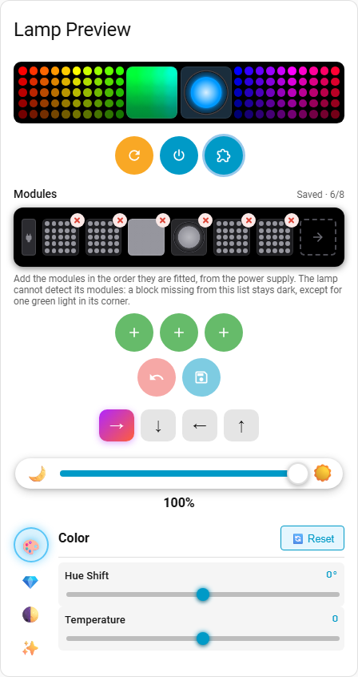
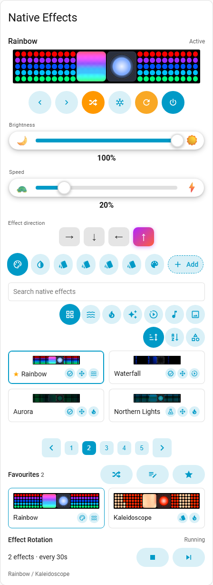
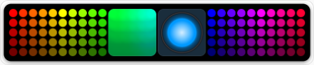

# Yeelight Cube Matrix support

> **Not the Cube Lite.** This page is about the original **Yeelight Cube** ("Cube Smart Lamp": a base and a chain of
> 1 to 8 modules: Matrix, Panel and Spot), which answers on the LAN as `model: CubeMatrix`. The cards, services and
> entities in the [README](../README.md) work on both lamps; this page covers what differs on a Cube Matrix.

<table>
  <tr>
    <td valign="top"> The Preview card on a Cube Matrix of six modules, its Modules section open</td>
    <td valign="top"> Native Effects on the same lamp: previews as wide as its modules</td>
  </tr>
</table>

 
Its Matrix Preview camera: each Matrix, Panel and Spot module drawn as it looks.

## The lamp in short

The Cube Matrix (software 1.12.92 on the lamp tested; LAN `fw_ver 92`) has two ways in:

- **Classic Yeelight LAN control**: colour, brightness, colour flows, pixel frames, its music modes. It has **no
  effect, clock or drawing command** on the LAN (no `set_fx_effect`, no `set_ps`).
- **Matter**: its own effects (the 13 of the Yeelight app and 37 more built in), its clock and its drawings (Yeelight's FC05 cluster, what the Yeelight app uses).
  Home Assistant reaches them once the lamp is shared to Home Assistant's Matter integration.

So the integration shows the lamp's **own** effects, clock and drawings over Matter when it can, and draws and
**streams** everything else (and everything, without Matter) over the LAN.

## Cube Lite and Cube Matrix compared

The two lamps share Yeelight's effect numbering and part of the LAN commands, and little else. **On a Cube Lite,
Matter is an extra** (buttons, GIF animations, orientation); **on a Cube Matrix, Matter is what lets the lamp run its
own effects** — without it, Home Assistant can only stream them.

| | Cube Lite | Cube Matrix |
|---|---|---|
| LAN model / Matter product id | `CubeLite` / 4 | `CubeMatrix` / 16787457 |
| Panel | fixed 20×5 | a base and a chain of up to 8 modules of 5×5 (5 columns each: 4 in a row are 20×5, 8 are 40×5) |
| LAN commands | about 38, including `set_fx_effect` and `set_ps` | the 30 its SSDP `support:` lists; any other answers "method not supported" |
| `get_prop` (read the lamp's state) | never answered | answered (modules, rotation, demo mode…) |
| Its effects, clock, animations over the LAN | yes, one command (`set_fx_effect`) | **no command at all** |
| Its effects, clock, drawings over Matter | yes (Yeelight cluster FC05) | yes (FC05): **the only way** |
| Its effects | about 100 slots, GIF animations | 50 the integration starts (13 offered by the Yeelight app, 37 more built in), no GIF |
| Microphone, music effects | yes | no microphone |
| Pixel frames (`update_leds`) | row by row; 25 frames a second over UDP | module by module, column by column; at most about 6 frames a second shown |
| Fast connection | UDP session | music mode (the lamp connects back to Home Assistant); its UDP shows streams late |
| Colours of a frame | sent as the lamp's LED drive | the lamp converts every pixel: sent as chosen |
| Mount | mount profile; effects compensated by Home Assistant | `rotation_angle` turns its own effects and clock, never frames |
| Settings (power-on behaviour…) | LAN (`set_ps`) | Matter only: Always on / Always off (no "restore") |
| Buttons | several, reported over Matter | one, no button events |
| Demo mode | — | about ten quick presses start a 30 s loop; only a factory reset ends it |
| Its own clock | LAN | Matter; needs 4 Matrix modules and Internet NTP |
| Connections | tolerant | 3 TCP slots, 30 commands a minute; heavy use can take it off Wi-Fi |

What the integration does with each:

| | Cube Lite | Cube Matrix with Matter | Cube Matrix without Matter |
|---|---|---|---|
| The lamp's 50 effects (13 of the app, 37 more built in) | the lamp's own (LAN) | **the lamp's own (Matter)** | streamed, about 5 frames a second |
| Other effects, animations | the lamp's own (animations as a GIF uploaded over Matter) | streamed over Matter, 25 frames a second | streamed |
| Clock | the lamp's own (LAN) | the lamp's own, styles 1–14 (Matter) | streamed |
| Text, pixel art, drawings | frames in direct mode over the LAN (UDP) | the lamp's drawing (Matter); scrolling text moves it | frames over music mode |
| Microphone effects, Music Flow, buttons, power-on setting | yes | not offered | not offered |

**After a factory reset** (to leave the demo mode, for example) the lamp loses its Matter pairing: share it to Home
Assistant's Matter integration again. Until then its effects are streamed. The integration links the new node (the
newest one with the lamp's address) and, once it answers, removes the old node the Matter server still lists (same
Wi-Fi MAC: a lamp is never paired twice on one server). The same applies to a Cube Lite paired again.

## What runs where

| What you select | Matter available (and the demo off) | Without Matter |
|---|---|---|
| One of the 13 effects the Yeelight app offers (Rainbow, Waves, Northern Lights (its Aurora), Ribbon, Fire, Spectrum, Starry Sky, Tide, Bouncing Ball, Building Blocks, Meteor, Waterfall, Hacking) in the Default color mode, its own colour, or a one-colour palette | **the lamp's own**, smooth, with speed, direction and colour, saved as the lamp's effect | streamed |
| One of the 37 other effects the lamp has built in (Fireworks, Solid red, Centre bursts, Two-colour alternation, Breathing, Moving palette, Particle path, Dual scan, Rotating colour bands, Dark palette pulses, Sine wave, Palette trails, Drop and bounce, Sunrise and sunset, Heat fire, Stacking blocks, Mirrored comets, Aqua-lime trails, Palette sparks, Scrolling bands, Palette cross-fade, Rising wisps, Tide (slot 35), Sine plotter, Rainbow noise, Rose Sea, Violet interference, Night-amber waves, Navy-white noise, Night-sky waves, Flicker sweep, Particle glows, Dot with fading trail, the four one-shot fill-ins and wipe-outs) in the Default color mode, its custom colour, or a palette of no more colours than it draws | **the lamp's own**, with speed, intensity, colours and direction | streamed |
| The music effects (not offered: no microphone), the effects the lamp does not have (Palette stripes, Random scatter, Neon sine bands, Magic, Wonderland, Violet twinkles, Kaleidoscope, Palette), the Cube Lite's versions of three it draws its own way (Aurora, Flower Sea, Triangular palette pulses), the integration's own effects (Knight Rider), a palette of more colours than an effect draws, another color mode (B&W, Vivid…) | streamed | streamed |
| Animations (Winter, Halloween, Dream, Moonlight) | streamed | streamed |
| Clock styles 1–14 (the lamp's own backgrounds) in the Default color mode, in a time zone of whole hours, the lamp mounted right or down | **the lamp's own clock**, time from the Internet | streamed |
| Other clock styles, palettes over a background, the lamp mounted left or up | streamed | streamed |
| Text, pixel art, drawings, gradients, images | **the lamp's drawing**, changed in place | frames over the LAN |
| Scrolling text | **the lamp's drawing**, its pixels changed at each step | frames over the LAN |
| Brightness, on/off, colour | LAN | LAN |
| Microphone effects, Music Flow, power-on behaviour, the Cube Lite's buttons | not offered (no microphone; no such settings) | not offered |

"Streamed" means Home Assistant draws the effect as the Cube Lite shows it and sends it frame by frame: with Matter
as the lamp's drawing, its pixels changed 25 times a second (as smooth as the lamp's own effects), without Matter
over the LAN at about 5 frames a second (the most the lamp shows there).
A streamed effect or clock needs Home Assistant running: the lamp keeps the last frame if it stops.

**What needs what.** Matter needs the lamp shared to Home Assistant's Matter integration (Yeelight app → the lamp →
multi-admin / share) and Home Assistant's Matter server from matterjs-server 1.5.4 (it sends Yeelight commands, see
[Matter commands](MATTER_COMMANDS.md)); the integration links the node by itself (its IP or MAC address), and falls back to streaming at once if a
command is refused. The lamp's own clock needs **4 Matrix modules** set in the Yeelight app's module setup and
Internet access to `pool.ntp.org`; the UTC offset is sent as whole hours and sent again when daylight saving time
changes it (in a time zone of half or quarter hours, Home Assistant's clock is streamed instead). **Without Internet
time** (a DNS filter blocking `pool.ntp.org`, for example) the lamp shows no digits: two salmon-coloured bars that
meet every 10 seconds instead. The styles over a background (Rainbow, Waves, Spectrum and 11–14) are sent no colour,
as the Yeelight app does, so the background keeps its own colours.

**Speed and direction** changes of an effect the lamp shows are sent live: the effect goes on without starting again,
and is not saved to the lamp each time.

**Directions** are as the light's Device Orientation shows the lamp: it follows the lamp's rotation, and the lamp turns
its own effects for its rotation. Both models lay a renderer's strip on the panel the same way (filmed 2026-11-12, side
by side, standing, at all four rotations: the same value drew the same picture on both), so the Cube Matrix's built-in
effects are sent the value that draws what a Cube Lite draws for the same Device Orientation, at the lamp's rotation;
every effect filmed on both lamps (Particle path, Palette trails, Rotating colour bands, Aqua-lime trails, Heat fire,
Stacking blocks, Scrolling bands, Violet interference, Rising wisps) already did. The Yeelight app's effects, which the
Cube Matrix draws its own way, take the values filmed for them (at rotation 0, lying with the base on the left):

| Direction | Up | Down | Left (toward the base) | Right (away from it) |
|---|---|---|---|---|
| The app's effects (Waterfall filmed) | 0 | 1 | 2 | 3 |
| Building Blocks, Waves (each arrow the other way) | 1 | 0 | 3 | 2 |
| Spectrum (no direction in the app; it takes one: where its gradient's red starts) | 0 | 1 | 3 | 2 |
| Flicker sweep (the app's arrows; a Cube Lite is sent the value that draws the same sweep) | 0 | 1 | 2 | 3 |

**One-line effects.** Moving palette, Sine wave and Hacking run along the lamp's long side only, whatever its rotation,
so their value is chosen for the rotation the lamp runs, as on a Cube Lite: forward (toward the lamp's top) on the value
it draws as 0, back on 1 (Hacking runs 2 and 3 as 0). On 0 and 1 the strip fills the lamp across first, so Moving
palette and Sine wave show bands across the lamp travelling along it, whatever the intensity; on 3 and 2 it fills the
long side first, and depending on the intensity the pattern seems to roll across the lamp instead. A direction that is
not along the line runs along it: Left as Up, Right as Down. The lamp kept its rotation through a 10-second and a
5-minute power cut (filmed).

**On and off.** A Cube Matrix switched off comes back with its effect sent in full: a Matter effect powers the lamp
on (filmed), a live change does not.

**Lamp mounted** (Device Orientation) writes the lamp's rotation over Matter; the lamp turns an effect or its clock
for it when it starts it, so Home Assistant sends what is shown again in full (filmed: at rotation 3, standing,
Waterfall "Up" climbs and "Right" runs to the viewer's right). Text and pictures read as the card's preview shows them.

**Freeze.** The lamp has no freeze of its own (the Cube Lite's command is not on its LAN). An effect or clock it shows
itself is replaced by a still picture of the frame Home Assistant's preview holds, not saved; a frozen clock's digits
are drawn again when the time changes. A streamed effect simply stops being sent, and the lamp keeps its last frame
(over the LAN filmed held 60 s; over Matter it stays as a drawing). Resuming sends the effect or clock again. **Color modes** (B&W, Vivid, Retro Orange, Tropical,
Violet & Gold) are the Cube Lite's own palettes, which the Cube Matrix does not have: they are streamed (filmed on
Rainbow, Ribbon and the Rainbow clock), over Matter 25 frames a second: over the LAN they showed about 5 a second,
which looked choppy next to the lamp's own effects (about 30).

**Power cuts.** The lamp's restart is seen in its Matter reboot count, reported with the effect it starts with (its
saved one) when Home Assistant's Matter server reaches it again, about 90 s after power-on (measured). That effect is
not taken for the lamp's button: Home Assistant's content is shown again, unless the Power-on behavior is Always off
(the lamp stays off, filmed) or the light is off. Text and pictures, which the lamp does not save, are also watched by
the health check every 10 s; saved effects and the clock every 60 s.

**Its address.** The lamp gets its address by DHCP; a Cube Matrix was seen moving to a new one overnight. The entry
follows it (from discovery, or from the address its Matter node reports), but giving the lamp a **fixed address
(DHCP reservation)** in your router avoids the gap.

**Home Assistant's own Matter light.** The Matter integration also creates a light for the shared lamp. Both control
the same lamp (on/off and brightness are one state); a colour set from the Matter light stops whatever effect runs. You
can hide or disable that entity.

## Every effect on a Cube Matrix

The Cube Matrix runs the same effects as the Cube Lite for modes 0–69, with a few of its own versions; 70 and above
exist only on the Cube Lite. With Matter (and the demo off), Home Assistant starts each effect the lamp has with one
command; the others are drawn by Home Assistant and streamed as the lamp's drawing (25 frames a second; without
Matter over the LAN, about 5 frames a second).

| On a Cube Matrix | Effects |
|---|---|
| **The lamp's own, looks the same** | Ribbon, Starry Sky, Spectrum, Waves, Rainbow, Waterfall, Bouncing Ball, Meteor, Tide, Building Blocks, Hacking (the Yeelight app's effects); Two-colour alternation, Breathing, Moving palette, Particle path, Dual scan, Rotating colour bands, Fireworks, Sine wave, Palette trails, Drop and bounce, Sunrise and sunset, Heat fire, Stacking blocks, Mirrored comets, Aqua-lime trails, Palette sparks, Scrolling bands, Palette cross-fade, Rising wisps, Tide (slot 35), Sine plotter, Rainbow noise, Violet interference, Navy-white noise, Night-sky waves, Flicker sweep, Particle glows, Dot with fading trail, Solid red, Centre bursts, the four fill-ins and wipe-outs |
| **The lamp's own versions, effects of their own** (a Cube Lite has them too) | Northern Lights (its Aurora: the aurora colours, where the Cube Lite's Aurora is green), Rose Sea (its Flower Sea: red to hot pink to purple, rows dimming towards the far end, one pace), Dark palette pulses (its Triangular palette pulses, on black where the Cube Lite's are on white). A Cube Lite shows Northern Lights itself and streams the other two |
| **The lamp's own, looks different** (the light's `matrix_own_versions` attribute) | Fire (turned 180°: burns from the other end), Night-amber waves (other constants; speed does nothing) |
| **Streamed by Home Assistant** | Palette stripes, Random scatter, Neon sine bands, Magic, Wonderland, Violet twinkles, Kaleidoscope, Palette, the four animations, and the Cube Lite's Aurora, Flower Sea and Triangular palette pulses |
| **Not offered** | the music effects (Music level glow, the music bars, Music bass-mid-treble colour, Music Spectrum, Gather, Breathing, Blossom, Music noise equalizer, Music Note, Music Impact): the Cube Matrix has no microphone, and Home Assistant has no sound to feed it |

**Colours.** The Cube Matrix treats colours differently from the Cube Lite: a colour that is not sent is black (the
Cube Lite uses white), and any colour list, even an all-black one, replaces an effect's own palette with shades
of its first colour. So Home Assistant sends:

- the colour you picked (or the palette's, in the palette colour mode), as on a Cube Lite;
- otherwise the effect's own colours (Rotating colour bands, Scrolling bands, Rising wisps, Two-colour alternation);
- otherwise, for an effect drawn in colour words (Sine wave, Breathing, Centre bursts, Particle glows, Dot with fading
  trail…), white, what the Cube Lite uses, so it looks as on a Cube Lite (Fireworks: one white, so its sparks take every
  colour); an effect drawn in colour words is also sent white for the words you did not pick (Particle glows with one
  colour: half its glows were black otherwise). Each lamp turns white into its own LED white: the Cube Lite's LED
  white sent as a colour came out amber on the Cube Matrix;
- otherwise no colour at all, so the effect shows its own palette.

It never sends an all-black list (which showed Sine wave and the palette effects as nothing) or more than 4 colours.

**Speed.** The Cube Matrix draws a frame about every 30 ms (the Cube Lite every 40 ms; Sine wave runs at 40 ms on
both): effects that move, fade or leave trails frame by frame (Particle path, Palette trails, Fireworks, Stacking
blocks…) run about 1.33 times faster and their trails are shorter; the fill-ins and wipe-outs take 3 s. The speed
setting cannot make up for it.

**Sunrise and sunset** reads its speed as a mode, as on a Cube Lite: 0 shows its whole picture, still; 1–60 is a
sunrise from black lasting that many minutes; 61–120 a sunset to black over (speed − 60) minutes; from 121 it cycles.
At a low speed it stays dark for minutes: that is the sunrise, not a fault.

**Intensity** is sent with the app's effects that take it (Starry Sky, Waves, Waterfall, Northern Lights, Bouncing Ball,
Meteor, Building Blocks), in the field the Yeelight app leaves empty. **Speed** is not offered for the effects whose
speed was filmed doing nothing on a Cube Matrix (Scrolling bands' neighbours 24 and 33, and the backgrounds 54–59:
Rainbow noise, Rose Sea, Violet interference, Night-amber waves, Navy-white noise, Night-sky waves).

**What the lamp starts itself** (its button stepping through its playlist, or the Yeelight app) is shown as the light's
effect or clock in Home Assistant (nothing is sent back); a drawing or a plain colour leaves the light as it was.

**Particle glows** is sent twice, 0.15 s apart: its glows take their colour when they appear, and the first ones
appear while the lamp is still fading from the previous effect's colours (they stayed dim for up to 45 s).

## The demo mode

About ten quick presses of the lamp's button start a **demo loop**: every 30 seconds the lamp shows its next effect by
itself and saves it. Neither the Yeelight app nor Home Assistant can turn it off; it survives power cuts. Only a
**factory reset** ends it (hold the button about 5 seconds within a minute of plugging the lamp in), which also erases
its Wi-Fi and Matter pairing: add it to the Yeelight app again, set its modules, and share it to Home Assistant again.

While the demo runs, anything the lamp shows itself lasts at most 30 seconds, but frames sent over the LAN are not
interrupted. So the integration then **streams everything** (as without Matter) and raises a **Repair** ("… is in demo
mode"). It reads the demo setting over the LAN (`get_prop show_off_mode`, at setup and every 30 minutes) and also
recognises the loop in the lamp's Matter reports (its running effect changing every 30 s while nothing was asked).

## Streaming

**Colours.** The Cube Matrix converts every pixel it is sent, as it does its own effects' colours. Its streams therefore
carry the effects' colours **before** the Cube Lite's colour conversion (white stays white). Text and pictures are sent
in the colours chosen, as for a Cube Lite.

**Transport.** Frames and commands go over the classic Yeelight **music mode** (`music_channel.py`): Home Assistant
asks the lamp (`set_music`) to connect back to it, then writes on that connection, unanswered and without quota; reads
(`get_prop`) go over a short TCP connection. While frames go, **direct mode is sent again at least every 2 seconds**:
sent once, a stream could freeze on its last frame after 10–20 seconds. **Home Assistant must accept an incoming TCP
connection from the lamp** on TCP port **55450** (another free one when it is taken; Home Assistant OS and a
host-network container do; a firewall or a bridged container may not). Without it nothing Home Assistant draws can be
shown (frames and direct mode never go over plain TCP: the lamp refuses them there); the connection is tried again
after 30 seconds, then 5 and 30 minutes (each try makes the lamp wait for a connection that never comes), and a
**Repair** says what to allow. Other commands (brightness, on/off) go one at a time on short TCP connections, at most
50 a minute; when the lamp still refuses one for its quota, they wait 30 s. A write the lamp does not take within 2 s
gives the music connection up rather than holding every control.

Before the lamp shows something of its own over Matter, the music connection is closed: while it is open the lamp
accepts Matter effects but does not show them.

**Frame rate.** Over the LAN the lamp shows every frame up to **6 a second**, so without Matter effects and clocks are
streamed at 5 frames a second (every 5th 40 ms render: they keep their speed but move in coarser steps than on a Cube
Lite; filmed 4.5–5.2 shown a second, against about 30 for the lamp's own effects). With Matter they are streamed as
the lamp's drawing instead, every 40 ms render as its new pixels (`setData`, shown and not saved): the lamp answered
about 45 a second and showed nearly every one (filmed 2026-11-11), so a stream is as smooth as the lamp's own effects.
After 3 frames in a row fail over Matter, the stream goes over the LAN until the effect is applied again.

**Keep connections few.** The lamp's TCP server has **3 client slots** (the music connection takes one) and a client
that connects and stops reading can stall it; heavy use (hundreds of connections) once took a lamp off Wi-Fi until it
was power-cycled. The integration keeps one music connection, opens short TCP connections only for reads, and uses no
UDP session with a Cube Matrix. Before the music connection opens it closes its own TCP connections, so the lamp has a
slot for it (with them open the lamp dropped it at once and streams stopped); a music connection that fails is tried
again after 30 seconds.

## Rotation

The lamp's **rotation** (the direction set in the Yeelight app's module setup, LAN `rotation_angle`, Matter FC02) says
how the lamp is mounted. It turns the lamp's own effects so they run the right way up, never pixel frames or drawings.
The integration takes it as the light's **Device Orientation**, which lays text, pixel art and the previews out for that
mounting (vertical pixel arts for a standing lamp):

| Rotation | Mounted | Device Orientation |
|---|---|---|
| 0 | lying, the base on the left | Right |
| 1 | standing, the base on top | Down |
| 2 | lying, the base on the right | Left |
| 3 | standing on the base | Up |

Rotation 0 and 3 were checked on the lamp with a camera (3: the lamp's own Waterfall runs up and Fire rises from the
base; pictures land as the standing preview shows them); 1 and 2 are the other two quarter turns. The rotation is read
at setup and followed over Matter when it changes in the app; choosing a Device Orientation in Home Assistant writes the
matching rotation to the lamp (over Matter), as the app does. **The lamp's own clock never turns its digits**: filmed
2026-11-12, it reads upright mounted right, from the top down mounted down, but upside down mounted left and from the
bottom up mounted up, where a Cube Lite reads upright and from the top down. So on a lamp mounted left or up the clock
is drawn by Home Assistant, turned as a Cube Lite's, and streamed (filmed: then both lamps read the same at every
orientation); the light's `mount_profile.clock_turned` tells the cards' previews.

## How the lamp is recognised

- **Discovery** (SSDP) accepts `model: CubeMatrix`; **Matter discovery** offers a Cube Matrix shared to Home
  Assistant's Matter integration (product id 16787457) that no entry has.
- **Manual setup:** the config flow asks the lamp `get_prop cube_topology rotation_angle strip_lenth`; a Cube Lite never
  answers `get_prop`, a Cube Matrix does. A Cube Matrix is added at once, its rotation as its mount.
- The model is stored in the entry (`model`). **An entry made by an earlier version** (every lamp was a Cube Lite then)
  learns it at the next start: from SSDP (`CubeMatrix`), else by asking the lamp (`get_prop`, waited for 2 s, twice).
  No answer is not taken for a Cube Lite at once (a Cube Matrix just powered on answers late): it is asked again at
  the next start, and stored as a Cube Lite after 3 starts without one. Its Cube-Lite-only entities (lamp buttons,
  Music Flow, power-on behaviour…) are removed instead of staying unavailable.
- `device_profile.py` holds what each model takes; the transport refuses locally any command a Cube Matrix does not
  list in its SSDP `support:` (e.g. `set_fx_effect`, `set_ps`; without SSDP, its known list of 30) with a clear error,
  and never sends it what it lists but should not get, the debug services included: `set_default` (overwrites its
  power-on state), `set_adjust` on `ct` (restarts the lamp), `set_segment_rgb` (blocks streamed frames for 3 s),
  `cron_*` (never answered) and `get_prop` of its stored effects. The button playlist service is refused too (the
  Cube Matrix's playlist takes other items; set it in the Yeelight app).

## Pixel order and modules

`cube_topology` lists the modules in chain order from the base (up to 8 slots; the Yeelight app offers 6, the
lamp keeps and reads back 8, tested 2026-11-21): **25 LEDs** for a type 1 (Panel) or 2
(Matrix) slot, **5** for a type 3 (Spot) slot; `strip_lenth` is their sum. A lamp nobody configured reports
`1,1,1,1,3,3` / 110 (4 blocks + two 5-LED slots that are not fitted): a **Repair** asks to set its modules in the
Yeelight app (its own clock needs 4 Matrix modules), and its rotation, the factory's, is not taken as its mounting.
A module list changed in the app is followed over Matter (the layout is built again), and it can be set from Home
Assistant too: `yeelight_cube.set_matrix_modules` sends the app's own command (FC02 `updateTopology`). On a
dashboard, the Preview card's **Modules** section sets them (README, Preview Card); the older Cube Matrix Modules
card is kept for the dashboards that have it.

**Modules left off the list** (filmed 2026-11-20 on Matrix, Matrix, Spot, Matrix listed as Matrix, Panel, Spot): the
lamp writes only the listed blocks and never blanks the others, which keep their last picture. After the last listed
LED it always sends one more fixed value, which lights the **first LED of the next block green** (about 40 %, the
same at any brightness, on every refresh). No LAN or Matter command reaches it; only listing that block removes it.
A Spot has an output of its own: with no Spot listed the lamp stops driving it and it keeps its last colour (seen
2026-11-21). `set_matrix_modules` with fewer blocks or fewer Spots switches the lamp off over Matter first (the listed
modules go black), writes the list, then switches it on again if it was on: the modules taken off stay dark, except
for that light.

Frames are drawn in "lamp order" (`row * 20 + column`, row 0 at the bottom) as for the Cube Lite, then
`DeviceProfile.to_wire` follows the slots: each block takes the next 5 columns, **column by column from the base side,
each column bottom → top**; any block beyond 20 columns is sent black. A drawing shown by the lamp over Matter uses the
same order (4 bytes a pixel, 25 pixels a module, one a Spot).

**Spot modules** (filmed 2026-11-14 with Matrix, Matrix, Spot, Matrix: topology `2,2,3,2`, `strip_lenth` 80): a Spot
is a single, very bright light (it washes the room in its colour). Of its 5 LEDs in a frame only the **first** lights
it; the other 4 do nothing. In the lamp's own effects it takes the colour of its place in the chain (it cycles with
Rainbow). Home Assistant does the same: a Spot covers a module's 5 columns of the picture, like a block, and lights
in their colour (their average, as bright as their brightest pixel), so effects run along the whole chain through
it. With fewer than 4 modules the lamp shows fewer than 20 columns (5 a module): effects are drawn on them, text
and the streamed clock fit them (`DeviceProfile.columns`), the lamp's own clock is not used (it needs 4 Matrix
modules) and the preview card hides the missing columns.

## Limits and open points

- **Any chain of 1 to 8 modules, in any order of Matrix, Panel and Spot.** Up to 4 modules, Home Assistant draws
  on a 20×5 panel as before (the columns past the modules are not shown). With 5 to 8 modules it draws on a panel
  5 columns a module wide (25 to 40 columns): streamed effects, the streamed clock, text, gradients, colours,
  drawings and the previews cover every module (filmed 2026-11-21 on Matrix, Matrix, Matrix, Spot, Panel: before,
  the Panel stayed dark whenever Home Assistant drew). The animations cover every module too: Snowfall repeats
  along the lamp, Daydream, Halloween glow and Moonlit clouds are stretched over it (repeated, they would show a hard
  edge every 20 columns). Pixel arts made 20 columns wide (the app's, those saved on a 20-column lamp) start at the
  base and leave the further modules dark; a drawing made on the lamp's own width covers it all. The streamed clock puts its digits on the 5×5 modules only,
  centred across them; a Spot shows the background. A Panel diffuses its light: it shows its part of the picture
  as a soft glow, not as dots. The previews (cards and cameras) draw them so (filmed 2026-11-21): a Spot as a
  round lens about 60% of the module wide in a bezel ring, glowing in its colour, nearly white at the centre when
  bright; a Panel as one face where its 25 colours melt into each other, a few lit pixels soft blotches.
- Filmed with Spot and Panel modules: Matrix, Matrix, Spot, Matrix and Matrix, Matrix, Matrix, Spot, Panel. 6 to 8
  modules are written to and read back from the lamp, not filmed (no such chain at hand).
- The streamed look-alikes differ a little from the lamp's own effects (Fire burns from the other end, Rainbow and
  Aurora differ in small details); the lamp's own are used whenever Matter allows. All built-in effects were filmed
  on the lamp; the directions were filmed at rotation 0, then standing at all four rotations.
- The music-mode connection is opened only for frames: opening it makes the lamp show the last frame over its own
  effect, so commands like brightness and on/off, and the connection check, go over plain TCP while it is closed.
- An effect the lamp shows itself is saved as its effect (as a tap in the Yeelight app does) and comes back after a
  power cut, unless the demo runs.
- **A setting a Cube Matrix has** (with Matter): **Power-on behavior** (Always on / Always off, its Matter
  `StartUpOnOff`; set to off, Home Assistant does not switch it back on after a power cut). What Home Assistant shows
  (text, pixel art…) goes as a still drawing: a new picture replaces the pixels, with no transition.
- Not exposed yet: the lamp's music modes (they need an audio source), the sleep timer (`set_scene auto_delay_off`),
  the button playlist and the follower counter.
- The firmware shows as the Yeelight app shows it (`1.12.92`; SSDP gives only `92`). A firmware older than 1.11.57
  takes no frames: a **Repair** asks to update it.
- The estimated power, the brightness stages and the colour calibration are the Cube Lite's (the Cube Matrix's
  brightness curve is steeper: mid levels look darker).
